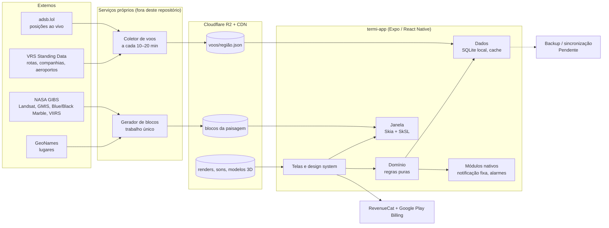
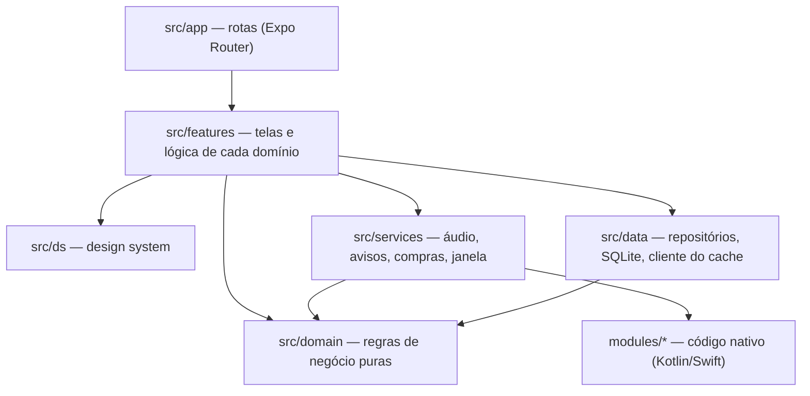
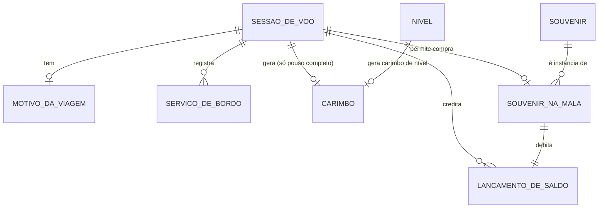
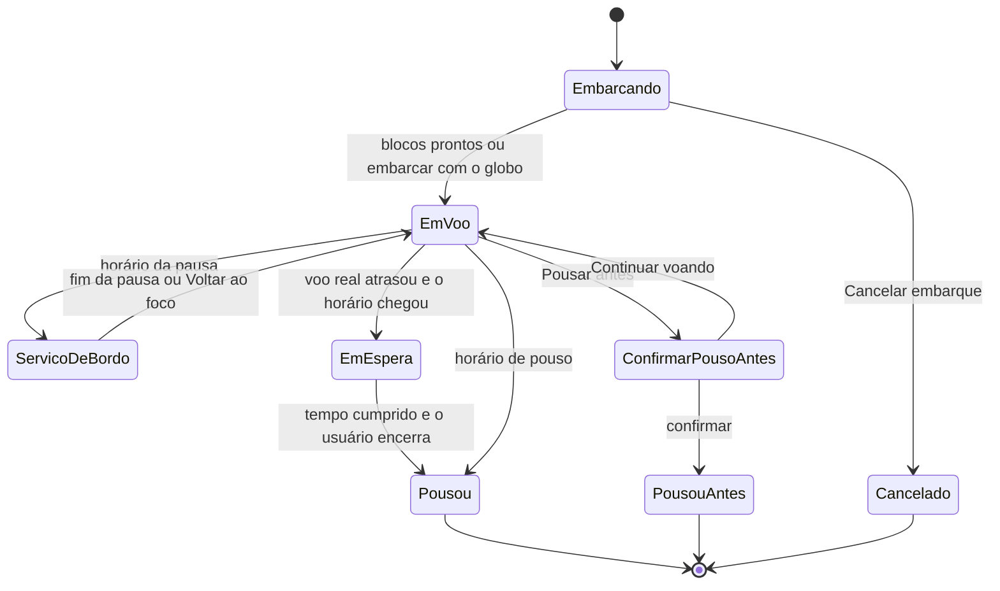

# Arquitetura técnica — Termi: Focus Flights

> Arquitetura do app de produção (`termi-app`) e dos serviços de que ele depende.
> Base: protótipo técnico validado no Android (`albertocolombara/termi-prototipo`, build-8) e os docs do projeto "visao-do-produto.md", "prototipo-tecnico.md", "infra-e-politicas.md" e "validacao-dados-voos.md".
> **O protótipo é a base técnica:** janela, design system em código, módulo nativo, pipeline de recursos da janela e medições de desempenho são reaproveitados. **As regras de produto vêm do PRD:** onde o protótipo diverge (ex.: "Desembarcar", pausa de 10 min no ciclo de 50), ele é ajustado, e isso não conta como inconsistência.
> Última atualização: 19/11/2026.

Status das decisões: **[Decidido]** (tomada e validada), **[Proposta]** (recomendação pendente de validação), **[Pendente]** (em aberto).

---

## 1. Visão geral

O Termi é um app **local-first**: a sessão de foco roda inteira no aparelho, guiada pelo relógio, e funciona sem conexão depois do embarque. O servidor só publica arquivos estáticos (lista de voos por região e blocos de paisagem) e não sabe quem é o usuário. Compras passam pela loja via RevenueCat.



**Escopo deste repositório [Proposta]:** só o app móvel. O coletor de voos e o gerador de blocos ficam em repositórios próprios (hoje o coletor de teste está em `albertocolombara/voo-ao-vivo-teste`). O contrato entre eles é o formato dos arquivos publicados (seção 9).

## 2. Stack tecnológica

| Camada | Tecnologia | Status | Responsabilidade |
|---|---|---|---|
| Framework | **React Native + Expo SDK 58** (development build, sem Expo Go) | [Decidido] | Base única Android e iOS |
| Linguagem | **TypeScript** (~6.0) | [Decidido] | Tipagem do app inteiro |
| React / RN | React 19.3, React Native 0.88, Reanimated 4.7, Skia 2.14 | [Decidido] (versões validadas no protótipo) | — |
| Janela | **@shopify/react-native-skia** (shader SkSL) | [Decidido] | Céu, terra, nuvens, asa e moldura |
| Animação de UI | **react-native-reanimated** 4 + worklets | [Decidido] | Animações e, a seguir, o ritmo da janela na thread de interface |
| Mascote | **Rive** (`.riv`, view model "Termi") | [Decidido] | Animações do Termi |
| Souvenirs 3D | **react-native-filament** | [Proposta] | Vitrine 3D com gesto de girar |
| Avisos | **expo-notifications** com gatilho de alarme exato (`setAlarmClock`) | [Decidido] | Pouso, início e fim do serviço de bordo |
| Notificação fixa | Módulo nativo próprio em Kotlin (`modules/screen-state`, Expo Modules API, do protótipo) | [Decidido] | Contagem regressiva até o pouso |
| Live Activity (iOS) | expo-widgets ou módulo Swift | [Proposta] | Fase iOS |
| Assinaturas | **RevenueCat** (Google Play Billing) | [Decidido] | Planos, vitalício, restauração, testes de preço |
| Navegação | **Expo Router** (rotas em `src/app/`) | [Decidido] | Navegação por arquivos, recomendada pelo Expo |
| Persistência local | **expo-sqlite** | [Decidido] | Voos, carimbos, mala, livro-caixa do saldo |
| Preferências | AsyncStorage (usado no protótipo) ou MMKV | [Proposta] | Ajustes simples |
| Estado de UI | **Zustand** | [Decidido] | Sessão ativa e estado global leve |
| Dados remotos | **TanStack Query** | [Decidido] | Cache, idade e retentativa dos JSON de voos |
| Mapa/globo | Globo em Skia (SkSL), em teste | [Proposta] | Ver ADR-11 e `src/globo` |
| Fontes | expo-font (Geist 400/500/600, Geist Pixel Grid) | [Decidido] | Tipografia do design system |
| Desfoque | expo-blur | [Proposta] | Efeito "Glass/Blur 12" |
| i18n | expo-localization + biblioteca de mensagens | [Proposta] | pt-BR no lançamento, en depois |
| Testes | Jest (jest-expo) + React Native Testing Library; Maestro para E2E | [Proposta] | Seção 14 |
| Erros em produção | Sentry | [Proposta] | Seção 14 |
| Build e distribuição | Repositório `albertocolombara/termi-app` no GitHub, com GitHub Actions gerando APK a cada push (como no protótipo); envio à Play a definir (EAS Submit ou manual) | [Decidido] / [Pendente] | Seção 15 |

Qualquer dependência nova passa pelas regras do [CLAUDE.md](CLAUDE.md) (instalar com `npx expo install`).

## 3. Organização em camadas



Regras de dependência:

1. `src/domain` não importa React, React Native, Expo nem nada de E/S. São funções puras e testáveis (elegibilidade, rendimentos, pausas, níveis, projeção de posição).
2. `src/ds` não conhece regras de negócio.
3. `src/app` só compõe telas de `src/features`; não contém lógica.
4. Código nativo só é acessado por `src/services`.

## 4. Estrutura de diretórios [Proposta]

O repositório está vazio. Estrutura proposta, reaproveitando o protótipo onde indicado:

```text
termi-app/
├── app.json / app.config.ts     # Configuração Expo (permissões, plugins, fontes)
├── eas.json                     # Perfis de build (development, preview, production)
├── .env.example
├── assets/
│   ├── fonts/                   # Geist Pixel Grid (OFL); Geist vem do pacote do Google Fonts
│   ├── rive/                    # termi.riv
│   ├── janela/                  # Renders mínimos embutidos (o resto vem da CDN)
│   ├── sons/
│   └── souvenirs/               # Imagens 2D de fallback
├── modules/
│   └── screen-state/            # Notificação fixa com contagem (do protótipo)
├── src/
│   ├── app/                     # Rotas Expo Router
│   │   ├── _layout.tsx
│   │   ├── (onboarding)/
│   │   ├── index.tsx            # Início
│   │   ├── voo/                 # dial, partidas, cartão, embarque, em voo, pouso
│   │   ├── mala/
│   │   ├── passaporte.tsx
│   │   ├── diario/
│   │   ├── estatisticas.tsx
│   │   ├── primeira-classe/     # paywall, compra concluída, gerenciar
│   │   ├── ajustes/
│   │   ├── sobre.tsx
│   │   └── ajuda.tsx
│   ├── features/                # Um diretório por domínio, com componentes e hooks
│   │   ├── onboarding/ inicio/ embarque/ em-voo/ pouso/
│   │   ├── colecao/ historico/ monetizacao/ ajustes/ conta/
│   ├── domain/                  # Regras puras + testes
│   │   ├── sessao/              # máquina de estados, horários, pausas
│   │   ├── voos/                # elegibilidade, projeção, previsão de pouso
│   │   ├── economia/            # dinheiro, preços, livro-caixa
│   │   ├── colecao/             # souvenirs, carimbos, níveis
│   │   └── geo/                 # distância, sol, lugar sobrevoado
│   ├── data/
│   │   ├── db/                  # Esquema SQLite e migrações
│   │   ├── repos/               # Repositórios por entidade
│   │   └── remote/              # Cliente do cache de voos e dos blocos
│   ├── services/
│   │   ├── avisos/              # expo-notifications + notificação fixa
│   │   ├── audio/
│   │   ├── compras/             # RevenueCat
│   │   └── bloqueio/            # Deep flight (condicionado)
│   ├── janela/                  # Do protótipo: Janela.tsx, shader.ts, tiles.ts, geo.ts
│   ├── ds/                      # Do protótipo (branch design-system, PR #1): tokens e componentes
│   ├── i18n/
│   └── config/                  # Leitura das variáveis de ambiente
└── docs/                        # Opcional: ADRs detalhadas
```

`android/` e `ios/` não são versionados: são gerados pelo `expo prebuild` (Continuous Native Generation).

## 5. Modelo de dados

### 5.1 Entidades

| Entidade | Onde vive | Campos principais |
|---|---|---|
| **VooAoVivo** (`LiveFlight`) | Cache remoto (somente leitura) | `hex`, `callsign`, `companhiaPais`, `origem`, `destino`, `lat`, `lon`, `altitudePes`, `velocidadeNos`, `rumo`, `pousoPrevistoEm`, `coletadoEm`, `regiao` |
| **SessaoDeVoo** (`FlightSession`) | SQLite | `id`, `voo` (cópia do `LiveFlight` no embarque), `tempoEscolhidoMin`, `embarcouEm`, `pousoPrevistoEm`, `encerrouEm`, `resultado` (`em_voo`, `pousou`, `pousou_antes`, `cancelado`), `minutosFoco`, `milhas`, `dinheiro`, `lugarSobrevoado`, `vooDeOntem` (bool), `configPausa` |
| **MotivoDaViagem** | SQLite (1:1 com sessão) | `categoria`, `foco`, `tarefas[]` (`texto`, `feita`) |
| **ServicoDeBordo** | SQLite (N:1 com sessão) | `inicioPrevisto`, `iniciouEm`, `terminouEm`, `voltouAntes` |
| **Carimbo** | SQLite | `id`, `sessaoId` (ou `nivel` para carimbos de nível), `aeroporto`, `cidade`, `pais`, `data`, `estilo` |
| **Souvenir** (catálogo) | Catálogo remoto versionado na CDN, com cópia embutida para o primeiro uso [Proposta] | `id`, `pais`, `tipo` (`pais`, `cidade`, `rara`), `metal` (níquel, cobre, latão), `preco`, `nomeNativo`, `modelo3d`, `imagem2d`, `disponivelDesde` |
| **SouvenirNaMala** | SQLite | `souvenirId`, `compradoEm`, `sessaoId`, `preco`, `amostra` (bool) |
| **LancamentoDeSaldo** (livro-caixa) | SQLite | `id`, `tipo` (`credito_voo`, `compra_souvenir`), `valor`, `sessaoId`, `souvenirId`, `criadoEm` |
| **Nivel** | Derivado das milhas | `nivel`, `alcancadoEm`, `recompensas` |
| **Direito** (`Entitlement`) | RevenueCat (cache local) | `primeiraClasse` (bool), `plano`, `expiraEm`, `vitalicio` |
| **Ajustes** | Preferências | serviço de bordo, sons, avisos, tela e bateria, privacidade, apps permitidos |

Decisões do modelo:

- **O saldo é a soma do livro-caixa**, não um número solto. Isso facilita auditoria, sincronização sem conflito e evita perder dinheiro por bug.
- **A sessão guarda uma cópia do voo no embarque.** O voo real pode sumir do cache; o histórico não pode.
- **Milhas e minutos totais são derivados das sessões.** O nível também.
- **A coleção não tem tamanho fixo.** Hoje são 13 países, e novos entram em pouco tempo. Total, progresso e espaços pontilhados vêm do catálogo vigente; um país novo nunca substitui outro nem afeta souvenirs comprados. Com o catálogo remoto, países novos entram sem nova versão do app (o modelo 3D é baixado sob demanda) [Proposta].
- **Registros são só acrescentados** (voos, carimbos, souvenirs, lançamentos). Nada que foi conquistado é apagado por regra de negócio; só por pedido explícito do usuário (UC-16).

### 5.2 Relacionamentos



## 6. Fluxo de dados

### 6.1 Escolher e embarcar

```mermaid
sequenceDiagram
  participant U as Viajante
  participant A as App
  participant C as CDN (R2)
  participant N as Avisos (sistema)
  U->>A: escolhe tempo no dial
  A->>C: GET voos/{regiao}.json (com cache)
  C-->>A: lista + coletadoEm
  A->>A: projeta posições até agora; filtra |pouso − tempo| ≤ 10 min
  U->>A: escolhe voo
  A->>C: baixa blocos da rota (~9 MB/h)
  A->>A: fixa pousoPrevistoEm; cria SessaoDeVoo
  A->>N: agenda pouso e serviços de bordo (alarme exato)
  A->>N: mostra notificação fixa
```

- **Sem consulta por usuário ao provedor de voos [Decidido].** Posição, rota e velocidade vêm do cache; o app projeta o resto.
- **Filtro de região no aparelho.** A localização (se concedida) só escolhe a região padrão; não sai do aparelho.

### 6.2 Sessão de voo (máquina de estados)



- **O relógio manda.** O estado é calculado a partir de `embarcouEm`, `pousoPrevistoEm`, das pausas e do relógio do aparelho. Ao reabrir o app (ou depois de o sistema encerrá-lo), a sessão é reconstruída sem perda.
- **O horário de pouso é fixado no embarque [Decidido, validado no protótipo].** Os avisos agendados dependem disso.
- **[Pendente] Em espera:** como o estado E5 se concilia com o pouso fixo. Proposta: o aviso de pouso toca no horário fixado; se o app estiver aberto e o cache mostrar o avião ainda no ar, a tela mostra "Em espera" com a opção de encerrar como pouso completo (o tempo escolhido já foi cumprido).

### 6.3 Pouso e rendimentos

Funções puras em `src/domain`:

- `rendimentos(sessao, agora)` → minutos, milhas (distância real voada no período), dinheiro ($1/min), carimbo (só pouso completo), loja (só pouso completo).
- `agendaDePausas(duracao, intervalo)` → lista de pausas que respeitam RN-05 a RN-07 (pausa de no máximo 5 min, em qualquer intervalo).
- `elegivel(voo, tempoEscolhido, agora)` → RN-02.
- `nivel(milhasTotais)` → RN-15.

## 7. Gerenciamento de estado

| Tipo de estado | Ferramenta | Exemplos |
|---|---|---|
| Persistente e conquistado | SQLite (fonte da verdade) | sessões, carimbos, mala, livro-caixa |
| Sessão ativa | Zustand, derivado do SQLite + relógio | estado do voo, tempo restante |
| Remoto | TanStack Query | voos por região, idade do cache |
| Assinatura | RevenueCat SDK + cache local | `primeiraClasse` |
| Preferências | AsyncStorage/MMKV | ajustes |
| Animações | Reanimated / Rive view model | `pensando`, `novoVoo`, `esteira`, `embarcou` |

## 8. Autenticação e autorização

- **Sem login para usar o app [Decidido].** O usuário é anônimo; o RevenueCat usa um ID anônimo do app.
- **Conta opcional para sincronizar [Decidido]; provedor [Pendente].** Opções a avaliar:

| Opção | Prós | Contras |
|---|---|---|
| Supabase (Auth + Postgres) | SQL, RLS, plano grátis, combina com o livro-caixa | Mais um serviço para operar |
| Firebase (Auth + Firestore) | Login com Google simples no Android | Modelo de documentos; lock-in |
| Só Android Auto Backup + login da loja | Zero servidor | Não sincroniza entre aparelhos; iOS diferente |

  **Decidido (19/11/2026): Supabase** (Postgres + Auth), projeto `eavuayeisrnzzpdbpugt`, região São Paulo. Plano grátis no desenvolvimento e no teste fechado; Pro no lançamento, pelos backups diários **[Proposta]**. Configuração: Data API ligada, sem exposição automática de tabelas novas e RLS ligado em toda tabela nova (cada usuário só lê e grava as próprias linhas). Só a chave publicável vai para o app; a chave secreta nunca sai do painel. Login: Google (e Apple no iOS) **[Proposta]**. Sincronização por eventos acrescentados (sessões, lançamentos, souvenirs), com união em vez de sobrescrita.
- **Autorização de recursos pagos:** decidida no app pelo direito do RevenueCat. Os recursos premium são locais (duração, vistas, sons, estatísticas), então não há API a proteger. A integridade do saldo é local; como a moeda não vale dinheiro real, o risco de fraude é aceito.

## 9. Integrações e serviços externos

| Serviço | Uso | Restrições |
|---|---|---|
| **adsb.lol** | Posições ao vivo (só pelo coletor) | Dados ODbL; crédito obrigatório; chave concedida com uso comercial; 1.000 chamadas/dia e 300/hora com chave; avisar ida à produção; planejar receptor ADS-B próprio |
| **VRS Standing Data** | Rotas, companhias (para o país da bandeira), aeroportos | Cobertura de rotas varia: 51% (Los Angeles) a 91% (Tóquio) |
| **NASA GIBS** | Blue/Black Marble, Landsat WELD 30 m, GMIS, VIIRS | Uso livre com crédito; sem logo nem sugestão de apoio da NASA; sem garantia de disponibilidade, por isso os blocos são copiados para o R2 |
| **GeoNames** | Nomes de lugares (lugar sobrevoado) | Crédito |
| **Cloudflare R2 + CDN** | Arquivos de voos, blocos, renders e assets | ~13 GB para o mundo todo (abaixo de 10 GB tirando áreas sem interesse) |
| **Oracle Cloud Always Free** | Coletor no início | Depois, Cloudflare Workers pago (US$ 5/mês) |
| **RevenueCat / Google Play Billing** | Compras | Chave pública no app; segredos só no painel |
| **Rive** | Animações do Termi | Exportar `.riv` do arquivo na nuvem |

**Contrato do cache de voos [Proposta]** (`/voos/{regiao}.json`):

```json
{
  "versao": 1,
  "regiao": "europa-oeste",
  "coletadoEm": "2026-11-19T15:40:00Z",
  "voos": [
    {
      "hex": "4ca7b5",
      "callsign": "RYR123",
      "companhiaPais": "IE",
      "origem": "BCN",
      "destino": "LGW",
      "lat": 45.12, "lon": 1.98,
      "altitudePes": 37000, "velocidadeNos": 450, "rumo": 335,
      "pousoPrevistoEm": "2026-11-19T16:52:00Z"
    }
  ]
}
```

Para o "voo de ontem" (RN-12), o coletor precisa guardar também a trilha do dia anterior **[Pendente]**.

**Catálogo da coleção [Proposta]** (`/colecao/catalogo.json`): `versao`, `atualizadoEm` e a lista de souvenirs (campos da seção 5.1), com URLs dos modelos 3D e imagens 2D. O app guarda a última versão e funciona offline com ela.

## 10. Segurança e proteção de dados

- **Nenhum segredo no app.** Tudo em `EXPO_PUBLIC_*` é público por definição. A chave do adsb.lol e as credenciais de escrita do R2 ficam só no coletor.
- **R2 público só para leitura**, por domínio próprio.
- **Dados pessoais mínimos:** sem nome obrigatório, sem telefone, sem anúncios, sem SDK de rastreamento publicitário. Motivos da viagem e tarefas ficam no aparelho (e no backend de sincronização, se o usuário criar conta).
- **Localização aproximada**, opcional, usada só no aparelho para escolher a região padrão.
- **LGPD:** exportar e apagar dados (UC-16); política de privacidade em Sobre o Termi.
- **Permissões Android:** `POST_NOTIFICATIONS`, `SCHEDULE_EXACT_ALARM`, `VIBRATE`, `ACCESS_COARSE_LOCATION`; para o bloqueio de apps (condicionado), "Acesso ao uso" e serviço em primeiro plano `specialUse`. **Proibidos:** serviço de Acessibilidade para bloqueio e `QUERY_ALL_PACKAGES`.

## 11. Validação e tratamento de erros

- **Dados remotos validados na entrada** (ex.: schema com Zod [Proposta]). Voo inválido é descartado, nunca derruba a lista.
- **Idade do cache:** se `coletadoEm` passar de um limite [Pendente, sugerido 45 min], o app trata como "Dados fora do ar" e oferece o voo de ontem.
- **Erros de rede** têm estado próprio (PRD, seção 10) e retentativa.
- **Escritas locais em transação** (crédito do voo + carimbo + lançamento juntos).
- **Erro nunca apaga progresso.** Em dúvida, a sessão é concluída a favor do usuário (pelo relógio).

## 12. Performance e escalabilidade

Lições medidas no protótipo (Samsung M35). Detalhes dos testes na seção 18:

- **Memória de textura abaixo de ~150 MB.** Acima de 256 MB (cache de GPU do Skia) o app travou a ~2 fps.
- **Paisagem em resolução reduzida e ampliada;** asa e moldura em resolução cheia, redesenhadas só quando a luz muda.
- **10 fps por padrão, 2 fps em economia.** O teto atual (~21 fps) vem do timer em JavaScript; o próximo passo é desenhar pela thread de interface (Reanimated).
- **Segundo plano sem trabalho:** janela desmontada e relógios parados (1% de bateria em 25 min de tela bloqueada).
- **Texturas comprimidas** (KTX2/Basis) no app nativo [Proposta].
- **Blocos baixados no embarque,** fora do APK (o protótipo embute ~21 MB de blocos só para Barcelona → Londres; ~26 MB com renders e mapas-base).
- **Escala:** o servidor não cresce com usuários; o custo é de leitura na CDN (~US$ 0,40/mês com 1.000 usuários ativos por dia).

## 13. Previsão de pouso (risco principal de dados)

Medição em 494 voos (validacao-dados-voos.md):

| Previsão inicial | Dentro de ±10 min |
|---|---|
| 25–59 min | 80% |
| 60–89 min | 70% |
| 90–179 min | 19% (só 16 voos) |
| 3–6 h | 35% |

Em voos longos a previsão superestima o tempo (usa a velocidade atual, baixa após a decolagem, e ignora vento de cauda). **Até corrigir, o app não deve oferecer horário de pouso em faixas sem validação** (PRD, seção 12). Melhoria proposta no coletor: usar velocidade de cruzeiro típica por tipo de aeronave e distância restante pela rota, e recalibrar com os pousos observados.

## 14. Testes e observabilidade

| Nível | Ferramenta [Proposta] | Cobertura mínima |
|---|---|---|
| Unidade | Jest (jest-expo) | Todo `src/domain`: pausas (exemplos da RN-07), rendimentos, elegibilidade, níveis, livro-caixa |
| Componente | React Native Testing Library | Componentes de `src/ds` e telas com regras (paywall, confirmação de pousar antes) |
| E2E | Maestro | Onboarding → caminho rápido → pousar antes; compra em ambiente de teste |
| Aparelho | Manual, roteiro fixo | Aviso de pouso com tela bloqueada (Android 14+), bateria, fps, memória; Samsung M35 e um Android mais fraco |

Observabilidade:

- **Erros:** Sentry [Proposta], sem dados pessoais.
- **Métricas de produto:** [Pendente] ferramenta. Precisa medir conversão, planos, voos concluídos e retenção (PRD, seção 15) sem SDK publicitário.
- **Diagnóstico na tela** (do protótipo: medidor de tela/JS/paisagem, camadas, quadros, qualidade, céu e nuvens) só em builds de desenvolvimento.

## 15. Ambientes e deploy

| Ambiente | Uso | Distribuição |
|---|---|---|
| `development` | Desenvolvimento com development build | `npx expo run:android` ou EAS `development` |
| `preview` | Testes internos | APK por GitHub Actions a cada push na `main` (como o protótipo) ou EAS `preview`; Play teste interno |
| `production` | Lançamento | EAS Build + Submit para a Play (teste fechado → produção) [Proposta] |

- O CI do protótipo gera só `arm64-v8a`, com memória limitada (Gradle 2 GB, Kotlin 1,5 GB) para caber no runner; o app de produção deve gerar AAB com as ABIs exigidas pela Play [Proposta].
- Atualizações OTA (EAS Update) só para JS; mudanças nativas exigem novo build.
- Política da Play antes do lançamento: declaração de alarmes exatos; teste do bloqueio de apps.

## 16. Decisões arquiteturais (ADRs resumidas)

| # | Decisão | Status | Motivo / trade-off |
|---|---|---|---|
| ADR-01 | React Native + Expo | Decidido | Android primeiro e iOS na mesma base; o autor é designer e o código é escrito com IA. Custo: módulos nativos para alarmes, notificação fixa e bloqueio. |
| ADR-02 | Janela em Skia (SkSL) com renders do Blender | Decidido | Validado a 60 fps de UI e baixo consumo. Custo: orçamento de textura apertado. |
| ADR-03 | Cache de voos compartilhado, sem consulta por usuário | Decidido | Chamadas ao provedor fixas; custo baixo. Custo: posição projetada, não ao vivo, entre coletas. |
| ADR-04 | Sessão guiada pelo relógio, pouso fixado no embarque | Decidido | Avisos confiáveis com o app fechado; sem trabalho em segundo plano. Custo: atraso real tratado como "Em espera". |
| ADR-05 | Sem turbulência, sem controle de saída | Decidido | Princípio de produto; evita serviço em segundo plano. |
| ADR-06 | Avisos como alarme exato (`setAlarmClock`) | Decidido | Doze adiava avisos aproximados. Custo: permissão "Alarmes e lembretes" e política da Play. |
| ADR-07 | Blocos e assets em Cloudflare R2 + CDN | Decidido | GIBS sem garantia; saída grátis. |
| ADR-08 | Local-first com SQLite e livro-caixa | Decidido | Funciona offline; facilita sincronização por união. |
| ADR-09 | Expo Router, Zustand e TanStack Query | Decidido | Padrão atual do Expo. |
| ADR-10 | Supabase para conta e sincronização | Decidido | Postgres combina com o livro-caixa e com a sincronização por união; plano grátis suficiente para o beta (~1 a 3 mil usuários sincronizando por alguns meses; o limite é o banco de 500 MB); sem backup automático no grátis. Ver seção 8. |
| ADR-11 | Globo em Skia (SkSL) | Proposta, em teste | MapLibre Native não tem globo. Teste em `src/globo` (ferramenta "Globo de teste"): Terra com Blue Marble mundial, detalhe da Europa e luzes noturnas pela posição do sol; rota, avião e cidades projetados com a mesma câmera; modos Planeta e Seguir; só redesenha quando a câmera ou o avião mudam. ~55 MB de textura (não fica montado junto com a janela). Prévia: `docs/imagens/globo-previa.png`. Falta medir no aparelho e decidir. Limite: abaixo de ~400 km de distância a textura mundial fica borrada fora da Europa (precisa de blocos, como a janela). |
| ADR-12 | Rive para o Termi; Filament para souvenirs 3D | Decidido / Proposta | Rive já tem as animações; Filament a validar em peso e memória. |
| ADR-13 | Protótipo como base técnica; PRD como base de produto | Decidido | Janela, design system, módulo nativo, recursos e medições já validados no aparelho são reaproveitados. Regras de produto divergentes no protótipo são ajustadas ao PRD. |
| ADR-14 | Catálogo da coleção remoto e versionado | Proposta | Novos países entram em pouco tempo; evita depender de nova versão na loja. Custo: download e cache dos modelos 3D. |

## 17. Riscos técnicos e pontos em aberto

| Risco | Impacto | Mitigação |
|---|---|---|
| Previsão de pouso ruim em voos longos | Alto: promessa central do produto | Corrigir no coletor e revalidar; limitar faixas oferecidas até lá |
| Política da Play para alarmes exatos | Alto: avisos atrasam | SCHEDULE_EXACT_ALARM com pedido no onboarding; tentar USE_EXACT_ALARM com argumento de timer |
| Bloqueio de apps rejeitado pela Play | Médio | Não prometer no paywall até aprovar; "Acesso ao uso" + `specialUse` |
| Memória de textura em aparelhos fracos | Médio | Níveis de qualidade, KTX2, teste em aparelho fraco |
| Dependência do adsb.lol (cota, disponibilidade) | Médio | Cache, voo de ontem, receptor próprio |
| Cobertura de rotas desigual por região | Baixo/Médio | Curadoria da lista; descartar rotas incoerentes |
| Peso de Rive + Filament + Skia no APK e na memória | Médio | Medir no aparelho; carregar sob demanda |
| Backend de sincronização não definido | Alto para RNF-10 | Decidir antes da fase de dados (ROADMAP) |
| Globo sem biblioteca pronta | Médio | Globo em Skia em teste (ADR-11); medir fluidez, bateria e memória no M35 |
| Nome/marca "Termi" provisório | Médio | Confirmar com agente de PI antes de investir na identidade |

## 18. Validação técnica realizada (protótipo)

Testes no Samsung M35, de 18 a 19/11/2026. Os resultados são a base das restrições da seção 12.

| Build | O que mudou | Resultado |
|---|---|---|
| build-4 | Janela com shader provisório (vista para frente), timer com tela bloqueada, regra dos 10 s | Tudo funcionou; a vista estava errada (cockpit). Decisão: tirar a turbulência |
| build-5 | Janela real (shader da "Janela ao vivo · com Blender" em SkSL) | App travado, ~2 fps em qualquer qualidade. Causa: texturas acima de 300 MB, além do cache de GPU do Skia (256 MB), reenviadas a cada quadro |
| build-6 | Texturas reduzidas para ~145 MB | Tela 60 fps, JS 60 fps; paisagem 9 fps com meta de 10. Com meta de 30, chega a 21 (limite do timer em JavaScript, não da GPU; a qualidade não muda o resultado). Janela igual à do protótipo web (aprovada). Avisos do serviço de bordo no horário num voo curto |
| build-7 | App parado em segundo plano (janela desmontada, relógios parados) | 1% de bateria em 25 min com a tela bloqueada (no build-6: de 35% para 33%). **O aviso de pouso não tocou** com a tela bloqueada |
| build-8 | Pedido de "Alarmes e lembretes" e avisos como `setAlarmClock` | Corrige a causa provável do build-7 (no Android 14+ o alarme exato vem negado e o expo-notifications cai para alarme aproximado, adiado pelo Doze). **Falta confirmar no aparelho** |

Outras medições:

- **Bateria com a tela ligada:** o app gastou 0,5% em 10 min (Configurações → Bateria, sem contar a tela).
- **Diagnóstico usado nos testes:** medidor (tela, JS, paisagem), camadas (paisagem, asa, moldura), quadros (2, 10, 30), qualidade (Econômica, Normal, Máxima), céu (hora real, dia, entardecer, noite) e nuvens (satélite ou geradas).
- **Build no CI:** APK de ~64 MB, dos quais ~26 MB são arquivos da janela (renders, mapas-base e blocos de Barcelona → Londres), que no app final serão baixados no embarque.
- **Termi em Rive (19/11):** state machine testada (pensando → comemora → pensando; pensando → espera → embarcou; volta ao Início depois do embarque).
- **Dados de voo:** ver seção 13 e o doc "validacao-dados-voos.md".

**App de produção, build-1 (19/11, Samsung M35):** a janela de teste manteve o desempenho do protótipo, e o **aviso de pouso tocou no horário com a tela bloqueada e o app fechado** (pendência do build-8 resolvida: alarme exato com a permissão "Alarmes e lembretes"). O catálogo do design system abriu, com ajustes visuais pedidos (ver ROADMAP, Fase 1).

Falta testar: Android mais fraco que o M35; paisagem pela thread de interface.

## 19. Recursos visuais: como foram gerados

### 19.1 Janela

**Origem.** O protótipo web "Janela ao vivo · com Blender" (https://claude.ai/artifact/4Bo3hcNDDDizLeZ6pXBYvd) foi aprovado e portado para SkSL no app, com a mesma câmera, terra, nuvens, céu e contas de rota e sol.

**Modelo 3D (Blender).** Arquivo `janela_23A.blend` (pasta `Documentos\Termi Blender` do Alberto). Cada vista da janela é uma **posição de câmera no mesmo modelo**. A vista pronta é a de um assento atrás da asa, olhando para o lado esquerdo: mostra o bordo de fuga, as carenagens dos flaps e o sharklet, sem motor.

**Renders.** Pasta `D:\Projetos 2026\Termi\Termi Blender`:

| Arquivos | Conteúdo |
|---|---|
| `tras_asa_*` | Asa, com fundo transparente, em três luzes (dia, entardecer, noite) |
| `tras_moldura_escura_*` | Moldura grafite (teste B: parede da cabine grafite, janela grande, degradê da cor do app no topo e na base), nas mesmas três luzes |
| `mini_2`, `mini_3` | Só miniaturas das vistas "Com asa" e "Asa e motor" |
| `asa_*` (na pasta do Blender) | Outro enquadramento, com a moldura clara descartada; não usar |

As camadas separadas compõem três vistas sem render extra: **Asa completa** (asa + moldura), **Só a janela** (só a moldura) e **Sem moldura** (só a asa). Faltam renders de "Com asa" e "Asa e motor" nos três horários.

No protótipo, as camadas entram como WebP de 1080 × 1440 com transparência: `asa_dia`, `asa_entardecer`, `asa_noite`, `asa_beacon` e `moldura_dia`, `moldura_entardecer`, `moldura_noite`. A troca entre as três luzes é suave, pela altura real do sol. Ao entardecer, a asa recebe um filtro quente (sépia 0,5, saturação 1,25, brilho 0,97), igual ao do protótipo web.

**Luzes da asa.** Só a luz branca de posição, fixa, na ponta (entardecer e noite) e o beacon vermelho da fuselagem em pulso lento e fraco (um a cada 3,6 s). Sem strobe e sem luz vermelha de navegação. Os pulsos param com "reduzir movimento".

**Camadas desenhadas ao vivo (shader SkSL).** Terra como esfera (raio 6.371 km) vista a ~10,5 km de altitude, a partir da posição e do rumo do avião:

| Camada | Fonte | Textura na GPU |
|---|---|---|
| Terra perto do avião | Landsat WELD 30 m sem nuvens (NASA), blocos no nível 10 (~61 m/px) | Atlas 2048 × 2048 |
| Terra a média distância | Landsat, blocos no nível 8 (~244 m/px) | Atlas 1024 × 1024 |
| Terra longe (dia) | Blue Marble, mapa-base `base_dia.jpg` | 2048 × 1792 |
| Terra longe (noite) | Black Marble, `base_noite.jpg`, e detalhe `det_noite.jpg` | 2048 × 1792 e 1280 × 1536 |
| Cidades à noite | Áreas construídas GMIS (blocos nível 9), moduladas pelo Black Marble e por um ruído de pontos | Atlas 1024 × 1024 |
| Nuvens | Imagem de satélite (NOAA-20/VIIRS, 16/11/2026) misturada com nuvens geradas por ruído (fbm); opção só geradas | 1024 × 1024 |
| Céu | Calculado: cor pela altura do sol, horizonte, brilho quente no nascer e no pôr, disco do sol, estrelas à noite, névoa pela distância | — |

Ajuste de cor final leve (dessaturação 12% e brilho +12%). A sombra das nuvens na terra só existe nas qualidades Normal e Máxima.

**Blocos de terra.** Baixados do NASA GIBS e empacotados em arquivos `.bin` por faixa de latitude (`w10_*`, `w8_*`, `i9_*`), com um `index.json` que liga cada bloco (`nível/x_y`) ao pacote, início e tamanho; o app lê só os bytes do bloco. Tamanho médio: 47,5 KB (nível 10), 41 KB (nível 8), 12 KB (áreas construídas). No protótipo, ~21 MB cobrem só Barcelona → Londres. Em produção: ~13 GB para o mundo todo no Cloudflare R2, gerados uma vez em lotes (ver "infra-e-politicas.md"), e ~250 blocos (~9 MB) por hora de voo baixados no embarque; no modo Econômica, sem o nível 10, ~3 MB por hora.

**Níveis de qualidade.**

| Qualidade | Resolução da paisagem em relação à tela | Terra perto (nível 10) | Sombra de nuvem |
|---|---|---|---|
| Econômica | 0,75× | Não | Não |
| Normal | 1,25× | Sim | Sim |
| Máxima | 2× | Sim | Sim |

A paisagem é desenhada num canvas menor e ampliada; asa e moldura ficam sempre em resolução cheia e só são redesenhadas quando a luz muda.

**Rota e sol.** Posição por arco de grande círculo, rumo e altura do sol calculados pela data, hora e posição (`geo.ts`). O protótipo voa Barcelona → Londres na velocidade real, porque os blocos empacotados cobrem esse trajeto.

**Pendências da janela.** Renderizar "Com asa" e "Asa e motor"; o mosaico Landsat é de ~2000 e com cara de verão (falta ajuste por estação); o sol sempre bate do mesmo lado da asa; texturas comprimidas (KTX2/Basis) no app nativo.

### 19.2 Souvenirs (medalhas)

- **Referência:** o Alberto gera uma imagem por país, no estilo das medalhas existentes, sem texto e com a faixa lisa embaixo.
- **Modelagem no Blender** (`Medalhas/blender`): as formas principais viram relevo de verdade; os detalhes finos (rosto, dobras, chama) vêm do sombreado da imagem, como textura por cima. A imagem de referência não é ampliada; o desenho vai até a borda e pode ser cortado por ela.
- **Padrão:** mesmo corpo e borda; campo em prata polida (espelho), relevo em prata jateada com bordas escurecidas; faixa lisa separada por filete curvo, com o nome do país em relevo, em arco, na fonte Bahnschrift, na forma nativa (日本 em Yu Gothic Bold).
- **Tripo descartada:** gerava modelos pesados e irregulares entre si.
- **Prontas:** Portugal, EUA, Brasil, Reino Unido, Japão e França. Prévia da vitrine: "Termi · Souvenir" (https://claude.ai/artifact/72WA1o8ii1Q7QcPLmKqY7f), com luz de estúdio escura e luz rasante; o grão jateado e o escurecimento das bordas ficam no material do app.
- **No app [Proposta]:** exportar em glTF/GLB para o react-native-filament, com imagem 2D de reserva.

### 19.3 Termi (Rive)

- Arquivo no Rive (nuvem): https://editor.rive.app/file/untitled/2737902 (ainda "Untitled"), artboard "Termi" de 400 × 400, fundo transparente, feito a partir das referências em `Mascote/Animações do Termi` (feitas no HyperFrames).
- Animações e view model descritos em DESIGN.md §14. Halo laranja atrás do Termi (desligado na esteira) e sombra no chão que encolhe quando ele pula.
- Pendências: nomear o arquivo, trocar o ícone provisório das moedas e exportar o `.riv`.
