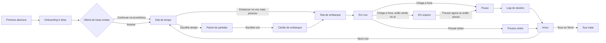

# PRD — Termi: Focus Flights

> Product Requirements Document. Define o produto do ponto de vista de negócio, experiência e funcionalidades.
> Fonte de verdade das decisões de produto: doc do projeto **"visao-do-produto.md"** (28ª versão, 19/11/2026). Este PRD organiza essas decisões em requisitos verificáveis.
> Última atualização: 19/11/2026 · Status: **v1 em definição** (protótipo técnico validado, app de produção ainda não iniciado).

Convenções deste documento:

- **[Decidido]**: decisão tomada pelo produto.
- **[Proposta]**: recomendação ainda pendente de validação.
- **[Pendente]**: dúvida em aberto, sem recomendação fechada.
- Identificadores: `RF-xx` (requisito funcional), `RNF-xx` (não funcional), `RN-xx` (regra de negócio). Os casos de uso (`UC-xx`) ficam em [CASOS_DE_USO.md](CASOS_DE_USO.md).

---

## 1. Visão e contexto

O Termi é um app de foco em que **cada sessão é um voo real que está acontecendo agora**. O usuário escolhe quanto tempo quer focar, embarca num avião que está no ar e pousa nesse tempo, e foca até o pouso. Pausas curtas acontecem no **serviço de bordo** (ciclo Pomodoro).

A experiência é simples como Forest e Focus Friend, mas imersiva: companhia (pela bandeira), rota, horário do dia, céu e paisagem vêm do mundo real.

**Personagem:** a mala **Termi** (de "terminal") é o avatar do app e guarda a coleção de souvenirs. Não tem pose oficial: aparece em posições diferentes conforme a tela.

**Posicionamento [Decidido]:** produto premium de nicho, não timer de massa. Preços no topo do mercado.

## 2. Problema e oportunidade

**Problema do usuário.** Quem estuda ou trabalha muitas horas por dia precisa de sessões longas de foco. Os apps de foco atuais:

- tratam o voo (ou a árvore) como decoração arbitrária, sem relação com o mundo real;
- punem quem sai do app (a sessão cai e os minutos se perdem), embora quem estuda no celular precise de PDF, calculadora e música;
- vendem recuperação de sessão, mostram anúncios ou ofertas durante o foco, escondem preço e tiram do grátis o que já foi conquistado;
- falham em avisar o fim da sessão e perdem progresso por bug.

Fonte: análise de 4.495 reclamações e sugestões em 9 apps (Forest, Opal, Flora, Focus Plant, Focus Friend, FocusFlight, Tide, Session, AirFlow), nov/2026.

**Oportunidade.** Nenhum concorrente usa voos reais ao vivo. Isso resolve a crítica mais repetida ao FocusFlight ("não dá para mudar a cidade de partida") e dá um encanto que justifica preço premium. A versão Android dos concorrentes é fraca; o Termi trata o Android como versão principal.

## 3. Objetivos do produto

1. Ajudar o usuário a acumular horas de foco com uma experiência que dá vontade de voltar.
2. Nunca punir o usuário: o tempo focado nunca se perde.
3. Validar no Brasil um produto premium sustentado só por assinatura e vitalício (sem anúncios).
4. Lançar no Android com qualidade de versão principal; iOS depois.

## 4. Público-alvo e necessidades

| Público | Contexto | Necessidades principais |
|---|---|---|
| **Principal (Brasil):** vestibulandos, concurseiros, universitários | Muitas horas de estudo por dia, muitas vezes no celular | Sessões longas, pausas, liberdade para usar outros apps, registro do que estudou, estatísticas |
| **Expansão (exterior):** público do "study with me" | Estudo/trabalho com ambiente imersivo | Atmosfera, sons, estética, coleção |
| Pessoas com dificuldade de foco (ex.: TDAH) | Pedido recorrente nas avaliações | Voos curtos, pausas, ausência de punição |

## 5. Proposta de valor e diferenciais

- **O voo é real e ao vivo.** Não há aeroporto de partida para configurar: o usuário entra em qualquer voo no ar que pouse no tempo escolhido.
- **O céu é real.** Hora do dia, nascer e pôr do sol e noite seguem a posição do avião.
- **Os sons seguem as fases do voo** (avisos do comandante, serviço de bordo, abaixo de 10 mil pés, preparação para pouso).
- **Pausa opcional, sem perda** (serviço de bordo).
- **Liberdade, não vigilância.** Sair do app não é punido. Quem quer rigor usa o bloqueio de apps (primeira classe).
- **Coleção ligada a lugares reais.** O souvenir é comprado ao pousar no país.
- **Milhas de verdade.** Distância real voada durante o foco.

## 6. Princípios do produto

1. **O tempo focado nunca se perde.** Pausar ou pousar antes nunca apaga minutos.
2. **Nunca tirar do grátis o que já foi conquistado.** Um souvenir comprado é do usuário para sempre.
3. **Sem anúncios. Nunca.** E nenhuma oferta que o usuário não pediu durante uma sessão. Se ele tocar num recurso da primeira classe, o paywall abre: foi ele quem pediu.
4. **Honestidade comercial.** Preço visível antes do trial, lembrete antes da cobrança, cancelamento fácil, sem contador falso nem selo sem dado real.
5. **Liberdade, não vigilância.** Sair do app não tem consequência.
6. **O mundo real é a base.** O céu é sempre o real; o premium muda o enquadramento, nunca a paisagem.
7. **Leve e confiável.** Abrir rápido, gastar pouca bateria, avisar o fim do voo sempre.
8. **Poucos passos até embarcar.** O ritual é charmoso, mas tem caminho rápido e animações puláveis.

---

## 7. Escopo funcional

### 7.1 Mapa de funcionalidades

| Domínio | Funcionalidades | Status |
|---|---|---|
| Onboarding | 5 telas sem cadastro, permissões explicadas, oferta de boas-vindas | Desenhado no Figma |
| Início e navegação | Início com Termi, menu lateral, perfil | Desenhado no Figma |
| Escolher e embarcar | Dial, painel de partidas, cartão de embarque, caminho rápido, tela de embarque | Desenhado no Figma |
| Em voo | Janela ao vivo, globo, sons, serviço de bordo, Pousar antes, estados | Janela, serviço de bordo, avisos e bateria validados no protótipo |
| Pouso e coleção | Pouso, loja do destino, mala, souvenir 3D, passaporte, status de viajante | Desenhado; 6 de 13 medalhas prontas |
| Histórico | Diário de bordo, estatísticas | Desenhado no Figma |
| Monetização | Paywall, oferta de boas-vindas, assinatura, vitalício | Desenhado no Figma |
| Conta e dados | Uso sem conta, sincronização opcional, exportar e apagar | Definição técnica pendente |
| Configuração e suporte | Ajustes, Sobre o Termi, Ajuda e sugestões | Desenhado no Figma |

"Desenhado no Figma" significa telas prontas no arquivo "Termi: Focus Flights"; **nenhuma funcionalidade está implementada no app de produção**. O protótipo técnico (`albertocolombara/termi-prototipo`) validou janela, serviço de bordo, notificação fixa, avisos agendados, desempenho e bateria, e **é a base técnica do app de produção** (ver ARCHITECTURE.md). Onde uma regra do protótipo diverge deste PRD (ex.: "Desembarcar", pausa de 10 min), vale o PRD.

### 7.2 Requisitos funcionais

#### Onboarding

- **RF-01** O app deve permitir começar sem cadastro, login ou telefone.
- **RF-02** O onboarding deve ter 5 telas: Abertura; Como funciona; Avisos da tripulação; Voos perto de você; Oferta de boas-vindas.
- **RF-03** Cada pedido de permissão do sistema (notificações, "Alarmes e lembretes" no Android 14+, localização aproximada) deve ser precedido de uma tela que explica o motivo. Recusar não bloqueia o uso.
- **RF-04** A oferta de boas-vindas deve ter "Continuar na econômica" sempre à vista, que leva ao dial no plano grátis.

#### Início e navegação

- **RF-05** O Início deve mostrar o Termi animado no centro, o botão "Novo voo" na base, o perfil (abre o menu lateral) e o saldo em $ no topo. Para a econômica, mostra também o Termi Premium, que abre o paywall.
  - **Início v3 (Figma, 24/11/2026; decidido pelo Alberto):** no lugar do Termi, um globo pontilhado com as rotas já voadas, girando devagar e interativo (gira, zoom pequeno, tocar numa rota mostra um bloco do voo); resumo do diário (voos e tempo de foco) com "Ver diário"; "Último voo" com "Repetir" (caminho rápido com o mesmo tempo de foco, UC-03); a marca **Plus** no cabeçalho (na econômica, abre o paywall).
- **RF-06** Tocar no Termi deve abrir a tela Sua mala, com a transição da mala abrindo.
- **RF-07** Ao tocar em "Novo voo", o Termi comemora antes de ir para o dial (animação pulável).
- **RF-08** O menu lateral deve dar acesso a: Perfil, Sua mala, Passaporte, Diário de bordo, Estatísticas, Primeira classe, Ajustes, Sobre o Termi e Ajuda e sugestões.

#### Escolher e embarcar

- **RF-09** O dial deve permitir escolher o tempo de foco de 15 min a 6 h. Na econômica, a faixa acima de 3 h aparece marcada como "primeira classe", sem abrir paywall.
- **RF-10** O painel de partidas deve listar voos no ar que pousam a até 10 min do tempo escolhido, do mais próximo ao mais distante, com filtros de região no topo ("Qualquer lugar" como padrão). A lista vem do cache de voos.
- **RF-11** Cada voo deve ser identificado por uma cauda pintada com a bandeira do país da companhia, rota, código e horário. Nunca por logo ou pintura real da companhia.
- **RF-12** Se nenhum voo encaixar, o app deve sugerir tempos próximos que tenham voos naquela região ou em "Qualquer lugar".
- **RF-13** O cartão de embarque deve permitir anotar o motivo da viagem (categoria, foco, checklist de tarefas), tudo opcional e salvo no histórico.
- **RF-14** O dial deve oferecer o caminho rápido "Embarcar no voo mais próximo", que pula partidas e cartão e vai direto à tela de embarque.
- **RF-15** A tela de embarque deve mostrar o Termi na esteira, as etapas reais (localizar o avião, baixar a paisagem da rota, preparar a janela) e "Cancelar embarque".
- **RF-16** Se a paisagem não baixar, o usuário deve poder embarcar com o globo; a janela fica disponível quando a conexão voltar.

#### Em voo

- **RF-17** A tela em voo deve mostrar a posição do avião, rota, altitude e tempo restante, num globo com dois modos de câmera (seguir o avião e visão de cima).
- **RF-18** A janela deve desenhar céu, terra e nuvens ao vivo pela posição e hora do voo, com asa e moldura renderizadas (dia, entardecer, noite) trocadas pela altura real do sol.
- **RF-19** O bottom sheet "Vista da janela" deve oferecer: Janela (grátis); Asa e Sem moldura (Plus). Decisão do Alberto em 24/11/2026: "Com asa" e "Asa e motor" ficam fora do lançamento.
- **RF-20** O app deve tocar sons de cabine e avisos conforme a fase real do voo. Os avisos do comandante são grátis e têm interruptor próprio, separado do som de fundo.
- **RF-21** O app deve executar o serviço de bordo (pausa) conforme a configuração do usuário e as regras RN-05 a RN-07, com aviso sonoro e notificação no início e no fim, mesmo com o app fechado, e o botão "Voltar ao foco".
- **RF-22** Durante o voo deve existir uma notificação fixa com contagem regressiva até o pouso (Android) e, no iOS, uma Live Activity.
- **RF-23** O botão "Pousar antes" deve abrir uma confirmação que mostra o que entra e o que não entra (RN-10), com "Continuar voando" como ação principal.
- **RF-24** A mensagem de boas-vindas do voo deve dizer que o usuário pode sair do app à vontade e pedir para não ligar o modo avião. Ela aparece no começo do voo, por cima da paisagem, e some depois (decidido em 20/11/2026).
- **RF-25** Na econômica, tocar numa vista, som ou qualquer outro recurso da primeira classe durante o voo deve abrir o paywall, como fora do voo (RN-20). O voo segue no horário com o paywall aberto; fechar volta ao voo.
- **RF-26** O app deve tratar os estados: Sem sinal do radar, Em espera, Sem internet (antes e durante o voo) e Dados fora do ar (seção 9).

#### Pouso e coleção

- **RF-27** O pouso deve disparar notificação com som, mesmo com o app fechado.
- **RF-28** A tela de pouso deve mostrar o carimbo, o que o voo rendeu, os serviços de bordo e o motivo da viagem com as tarefas feitas, e abrir a loja do destino.
- **RF-29** A loja do destino deve oferecer o souvenir do país de pouso, com prévia dentro da mala antes de gastar o dinheiro.
- **RF-30** Sua mala deve mostrar os souvenirs organizados, os que faltam pontilhados com o nome do país, a barra de progresso sobre o catálogo vigente (hoje 13 países), o saldo e um espaço "Em breve".
- **RF-31** Tocar num souvenir deve abrir a vitrine com o souvenir 3D, que gira com o dedo e volta de frente ao soltar, com nome, tipo, onde foi comprado, em qual voo, por quanto e o atalho "Ver o carimbo no passaporte".
- **RF-32** O passaporte deve mostrar os carimbos de cada pouso (código do aeroporto, cidade, data), em várias páginas, com o resumo de carimbos, países e milhas.
- **RF-33** O app deve calcular o status de viajante pelas milhas acumuladas e entregar as recompensas de nível (RN-15).

#### Histórico

- **RF-34** O diário de bordo deve listar todos os voos agrupados por dia, filtráveis por categoria, com detalhe de horários, rendimentos, motivo da viagem, tarefas e serviços de bordo.
- **RF-35** As estatísticas devem mostrar total da semana com comparação, foco por dia e por categoria, voos, pousos, pousos antecipados, serviços de bordo, sequência de dias e recorde. ~~Na econômica, só a semana; na primeira classe, também mês e ano.~~ **Figma v3 (24/11/2026, decidido pelo Alberto):** dia, semana, mês e ano liberados para todos, com o globo das rotas do período; o Plus libera os blocos a partir de "Por categoria" (e os blocos de desempenho que ainda serão desenhados depois dela).

#### Monetização

- **RF-36** O paywall (P1) deve ter carrossel de benefícios (automático a cada 3,5 s e ao arrastar), planos Anual, Mensal e Vitalício lado a lado (anual selecionado), condições que mudam com o plano, "Continuar na econômica" e "Restaurar compras · Termos · Privacidade".
- **RF-37** A compra deve ser feita pela loja (Google Play Billing; App Store no iOS), com restauração de compras.
- **RF-38** Ajustes > Primeira classe (P5) deve mostrar o plano atual, o lembrete antes da cobrança, gerenciar no Google Play, restaurar compras e cancelar em dois toques.
- **RF-39** A compra concluída (P4) deve mostrar a data do lembrete antes da cobrança.
- **RF-40** O bloqueio de apps (deep flight) deve permitir escolher apps permitidos, ajustar a lista durante o voo e sempre ter saída de emergência. **Condicionado à aprovação da Play Store (RN-23).**
- **RF-41** Widgets da primeira classe. **[Pendente]** Conteúdo e fase de lançamento não definidos.

#### Conta, dados e configuração

- **RF-42** O usuário deve poder criar uma conta opcional para sincronizar o progresso entre aparelhos.
- **RF-43** O progresso (voos, mala, saldo, carimbos, milhas) deve ter backup desde a v1, para nunca se perder por reinstalação ou troca de aparelho. **[Pendente]** mecanismo (ver ARCHITECTURE.md).
- **RF-44** Os Ajustes (M5) devem cobrir: voo (serviço de bordo e intervalo; apps permitidos), som, avisos (pouso, serviço de bordo, lembrete de voo), tela e bateria (manter tela ligada, economia de bateria, qualidade da janela, reduzir movimento), conta e compras, privacidade (voos perto de você, exportar e apagar dados).
- **RF-45** O usuário deve poder exportar e apagar seus dados.
- **RF-46** Sobre o Termi deve mostrar os créditos dos dados (adsb.lol, NASA GIBS, ESA WorldCover / Copernicus Sentinel-2, OpenStreetMap, GeoNames), o agradecimento do GIBS, a atribuição do ESA WorldCover, a nota de que o uso de dados da NASA não implica apoio da NASA, a nota sobre companhias aéreas e os documentos legais.
- **RF-47** Ajuda e sugestões deve ter perguntas frequentes em sanfona e contato (sugestão, relatar problema com o último voo, avaliar na loja).
- **RF-48** Se os avisos de pouso estiverem desligados, o Início deve mostrar um aviso para ativá-los.

### 7.3 Requisitos não funcionais

| ID | Requisito | Critério verificável |
|---|---|---|
| RNF-01 | **Plataforma** | Android primeiro, com qualidade de versão principal; iOS depois, mesma base de código. |
| RNF-02 | **Bateria em segundo plano** | Em segundo plano o app não desenha nem roda relógios. Referência medida (Samsung M35): ~1% de bateria em 25 min de voo com a tela bloqueada. |
| RNF-03 | **Bateria com a janela aberta** | Referência: ~0,5% em 10 min (consumo do app, sem a tela). |
| RNF-04 | **Quadros da janela** | 10 fps por padrão; 2 fps em economia de bateria ou bateria baixa. |
| RNF-05 | **Memória de textura** | Abaixo de ~150 MB (acima do cache de GPU do Skia, 256 MB, o app trava). |
| RNF-06 | **Dados móveis** | Blocos da rota baixados no embarque: ~9 MB por hora de voo (~3 MB no modo Econômica); nenhum download obrigatório durante a sessão. |
| RNF-07 | **Confiabilidade dos avisos** | Avisos de pouso e serviço de bordo entregues no horário com a tela bloqueada e o app fechado (alarme exato no Android). |
| RNF-08 | **Funcionamento offline em voo** | Se a conexão cair durante o voo, o foco continua e a posição é estimada. |
| RNF-09 | **Escala dos dados de voo** | O número de chamadas ao provedor de voos não cresce com o número de usuários (cache compartilhado). |
| RNF-10 | **Integridade do progresso** | Nenhum fluxo pode apagar minutos, milhas, carimbos, saldo ou souvenirs já conquistados. |
| RNF-11 | **Privacidade** | Sem login obrigatório. Localização opcional e aproximada, usada no aparelho. Sem anúncios nem rastreamento publicitário. |
| RNF-12 | **Acessibilidade** | Respeitar "reduzir movimento" do sistema (animações e pulsos param); áreas de toque adequadas; textos legíveis no tema escuro. Detalhes em DESIGN.md. |
| RNF-13 | **Áudio** | O som não corta em segundo plano nem com a tela desligada. |
| RNF-14 | **Idiomas** | Português (Brasil) no lançamento; inglês logo depois da validação. Textos externalizados desde o início. |
| RNF-15 | **Desempenho em aparelhos fracos** | Níveis de qualidade automáticos (resolução, blocos de terra, sombra de nuvem). **[Pendente]** medir num Android mais fraco que o M35. |
| RNF-16 | **Abertura rápida** | **[Pendente]** meta numérica de tempo de abertura. |
| RNF-17 | **Coleção expansível** | Novos países entram no catálogo sem quebrar a mala, o progresso ou os souvenirs já comprados. Sem exigir nova versão do app (catálogo remoto, decidido em 25/11/2026). |

---

## 8. Regras de negócio

### Sessão e voo

- **RN-01 — Duração.** O tempo de foco vai de **15 min (mínimo)** a 6 h. Econômica: até 3 h (inclusive). Primeira classe: até 6 h. Se muitos usuários encostarem no limite, ele pode subir para 8 h.
- **RN-02 — Voo elegível.** Um voo é elegível se está no ar e o pouso previsto fica a até 10 min do tempo escolhido. A ordenação é pela diferença em relação ao tempo escolhido.
- **RN-03 — Tempo de foco = duração do voo.** As pausas do serviço de bordo não descontam nada: o voo inteiro conta.
- **RN-04 — Sair do app é livre.** Bloquear a tela, trocar de app ou usar o celular não tem consequência.

### Serviço de bordo (pausa)

- **RN-05 — Intervalos.** "A cada 25 min" (padrão, Pomodoro clássico), "A cada 50 min" ou "Desligado".
- **RN-06 — Duração da pausa.** **Máximo de 5 min em qualquer intervalo** (25 ou 50 min); o usuário pode voltar antes ("Voltar ao foco"). O voo segue no horário.
- **RN-07 — Limites.** Nenhuma pausa em voos de até 30 min; precisa sobrar **pelo menos 10 min de voo depois da pausa** (folga mínima, decidida em 19/11/2026). Exemplos com o ciclo de 25 min: voo de 52 min tem 1 pausa; de 1h30, 2; de 3 h, 5.

### Fim do voo

- **RN-08 — Pouso completo.** Rende: minutos do voo inteiro (pausas incluídas), milhas da distância real voada, carimbo no passaporte, $1 por minuto e acesso à loja do destino.
- **RN-09 — O tempo é do usuário.** O foco dura o tempo do voo escolhido no embarque (horário de pouso fixado no embarque). Quando esse horário chega, o voo conta como **pouso completo** (RN-08), esteja o avião real no ar ou não. O usuário nunca é obrigado a ficar até o avião pousar (decidido pelo Alberto em 19/11/2026).
- **RN-09a — Em espera (continuar até o pouso).** Se o horário chegou e o avião real ainda está no ar, o app oferece "Continuar até o pouso", sem obrigação. Os minutos a mais contam como foco ($1 por minuto, milhas do trecho a mais). O usuário pode encerrar a qualquer momento ("Pousar agora") e continua com o pouso completo. Se o avião pousar enquanto ele continua, o voo encerra ali. Os minutos a mais contam a partir de quando ele escolhe continuar (não do horário), e o app só oferece continuar com uma leitura recente do radar mostrando o avião no ar; na dúvida, o voo pousa no horário. Telas: Figma v3, "E5 · Em espera" (proposta de 25/11/2026) e "E5b · Continuando até o pouso".
- **RN-09b — Em solo (avião pousou antes do horário).** Se o avião real pousar antes do horário escolhido, o foco segue até o horário: a janela mostra o avião no solo (taxiando ou no portão) e o pouso completo vem no horário escolhido.
- **RN-10 — Pousar antes** (encerrar antes do horário escolhido). Rende: minutos até ali, milhas do trecho voado, $1 por minuto voado. Não rende carimbo nem loja do destino. O voo fica no diário como "Pousou antes". (O lugar sobrevoado saiu por decisão do Alberto em 25/11/2026: pouco relevante para o usuário.)
- **RN-11 — Sem recuperação.** Nunca recuperar um voo pagando ou de qualquer outra forma.
- **RN-12 — Dados fora do ar.** O app oferece refazer o voo real de ontem, no mesmo horário. Conta igual a um voo ao vivo.

### Economia e coleção

- **RN-13 — Moeda do jogo.** Dólar com símbolo $, sem parecer dinheiro real nem sacável. Só se ganha voando ($1 por minuto, pausas incluídas). Não se compra com dinheiro real.
- **RN-14 — Souvenirs.** Comprados na loja do destino, depois de um pouso completo no país. Preços: país (níquel) $200; cidade (cobre) $100; rara (latão) $500. Na econômica, até 2 souvenirs de amostra, que são do usuário para sempre; a tentativa de comprar o 3º abre o paywall. **Plus:** a loja fica aberta a qualquer hora (tela "Lojas") para todos os países onde o usuário já teve um pouso completo, sem precisar pousar de novo. Na econômica, a tela "Lojas" aparece, para o usuário saber que existe, mas fica bloqueada: comprar fora da tela de pouso é do Plus. (Decidido pelo Alberto em 25/11/2026; antes eram 3 souvenirs na econômica e a loja só abria no pouso. Quem já tiver mais souvenirs que o limite continua com todos.)
- **RN-15 — Status de viajante.** Níveis por milhas acumuladas (milhas não se gastam):

| Nível | Milhas | Recompensa (grátis para todos) |
|---|---|---|
| Turista | 0 | — |
| Mochileiro | 1.000 | Adesivo no Termi + carimbo de nível |
| Viajante | 5.000 | Adesivo + carimbo |
| Explorador | 15.000 | Adesivo + carimbo |
| Desbravador | 35.000 | Adesivo + carimbo |
| Cidadão do mundo | 70.000 | Adesivo + carimbo |
| Nômade | 120.000 | Adesivo + carimbo + medalha rara exclusiva (latão) |

  Nenhum nível dá dinheiro do jogo como recompensa.
- **RN-16 — Coleção só cresce.** Países novos se somam; nunca substituem outros. Nome do país na medalha na forma nativa.
- **RN-17 — Coleção atual.** Medalhas de 13 países: Brasil, Japão, Portugal, Espanha, França, Itália, Alemanha, Holanda, EUA, Reino Unido, Argentina, Chile e Uruguai. **Novos países serão adicionados em pouco tempo**, sempre somando (RN-16). Nenhuma tela, cálculo ou texto deve assumir um total fixo. Moedas de cidade ficam para depois.

### Monetização

- **RN-18 — Sem anúncios**, nunca.
- **RN-19 — Planos (Brasil, lançamento):** Mensal R$ 14,90; Anual R$ 89,90 (7 dias grátis, "Economize 50%"); Vitalício R$ 179,90 (compra única). Oferta de boas-vindas: 1º ano do anual por R$ 59,90 (−33%), com os 7 dias grátis. O período grátis existe só no anual.
- **RN-20 — Quando o paywall abre:**
  - **Regra geral (decidida em 19/11/2026): na econômica, tocar em qualquer recurso da primeira classe abre o paywall, a qualquer momento, inclusive durante o voo.** Exemplos: comprar o 3º souvenir, comprar pela tela "Lojas" fora do pouso, uma vista da janela ou um som exclusivo, mês ou ano nas estatísticas, o Termi Premium no Início, o item "Primeira classe" do menu e "Conhecer a primeira classe" na mala.
  - Oferta de boas-vindas: no fim do onboarding e depois do 3º voo (mesma oferta, sem contador), sempre fora do voo.
  - **Entre o embarque e o pouso, nenhum paywall, banner ou lembrete de assinatura abre sozinho.** Só o toque do usuário abre.
  - **Exceção: o dial.** A faixa acima de 3 h aparece visualmente como conteúdo da primeira classe, mas não abre o paywall, para não atrapalhar a escolha do tempo (RF-09; decidido em 19/11/2026).
- **RN-21 — Honestidade comercial.** O desconto não muda ao tentar fechar a tela; sem contador de urgência; sem selos como "mais escolhido" ou "melhor valor" sem dado real; lembrete antes da primeira cobrança.
- **RN-22 — O céu é sempre o real.** O premium muda só o enquadramento da janela (asa, motor, moldura) e os sons de fundo.
- **RN-23 — Bloqueio de apps.** Só entra no paywall e no app depois de aprovado num teste na Play Store. Tem lista de apps permitidos, sem limite arbitrário, editável durante o voo, e sempre uma saída de emergência.

### Marca e dados

- **RN-24 — Companhias aéreas.** Identificadas só pela bandeira do país, nunca por logo ou pintura real.
- **RN-25 — Créditos.** Os dados de terceiros (adsb.lol/ODbL, OpenFlights/ODbL, NASA, ESA WorldCover/CC BY 4.0, OpenStreetMap/ODbL, GeoNames; desde 21/11/2026 o ESA WorldCover substitui o Landsat WELD e o GMIS) são creditados em Sobre o Termi; não usar o logo da NASA nem sugerir apoio da NASA. Os sons de fundo são CC0 (domínio público, sem crédito obrigatório) ou gerados pelo próprio Termi (voo de cruzeiro e ruído branco); o Termi credita os autores mesmo assim: Freesound (flood-mix, triadtravelogues, BonnyOrbit) e o lofi (álbum "Lo-fi And Chill", HoliznaCC0). Som com licença não comercial (CC BY-NC) não entra (20/11/2026).

### Comparativo de planos

| | Econômica (grátis) | Primeira classe (pago) |
|---|---|---|
| Duração do voo | Até 3 h | Até 6 h |
| Serviço de bordo | Sim | Sim |
| Carimbos no passaporte | Sim | Sim |
| Souvenirs | Até 2 de amostra, comprados na tela de pouso | Todos, e a loja dos países já pousados a qualquer hora |
| Sons de fundo | Voo de cruzeiro (ruído marrom gerado) e ruído branco | Também motores (gravação real), cabine, chuva e lofi (playlist) |
| Vista da janela | Janela | Todas as vistas (Asa e Sem moldura) |
| Bloqueio de apps | — | Sim (condicionado, RN-23) |
| Estatísticas | Semana | Também mês e ano |
| Widgets | — | Sim ([Pendente], RF-41) |
| Regiões e rotas | Todas | Todas |

---

## 9. Fluxos principais do usuário

Fluxos detalhados, alternativos e exceções: [CASOS_DE_USO.md](CASOS_DE_USO.md).

## 10. Estados de interface e tratamento de erros

### Estados do voo

| Estado | Comportamento |
|---|---|
| Serviço de bordo (E2) | Pausa de até 5 min, contagem regressiva, "Voltar ao foco". |
| Fim do serviço de bordo (E1) | Aviso discreto "De volta ao foco", com o horário do pouso. |
| Pousar antes (E3) | Confirmação com o que entra e o que não entra; "Continuar voando" principal. |
| Sem sinal do radar (E4) | Dado ao vivo caiu; posição estimada; foco continua. |
| Em espera (E5) | O horário chegou e o avião real ainda está no ar: pouso completo garantido; opção "Continuar até o pouso" ou "Pousar agora" (RN-09a). |
| Em solo (E8) | O avião real pousou antes do horário: a janela mostra o avião no solo e o foco segue até o horário; pouso completo no fim (RN-09b). |
| Pouso (E6) | Carimbo, rendimentos, loja do destino. |
| Pousou antes (E7) | Minutos, milhas e dinheiro proporcional; sem carimbo nem loja. |

### Erros e estados vazios

| Situação | Comportamento |
|---|---|
| Nenhum voo encaixa | Sugere tempos próximos com voos na região ou em "Qualquer lugar". |
| Dados de voo fora do ar | Oferece o voo real de ontem, no mesmo horário; conta igual. |
| Sem internet antes do embarque | Explica que é preciso conexão para achar o avião; botão de tentar de novo. |
| Sem internet durante o voo | Foco continua; posição estimada. |
| Paisagem não baixou | Embarcar com o globo; janela quando a conexão voltar. |
| Mala vazia / diário vazio | Estado vazio com convite ao primeiro voo (botão secundário). |
| Avisos de pouso desligados | Aviso no Início para ativar. |

Telas no Figma: seções "Estados do voo · v2" e "Erros e estados vazios · v2". Padrões visuais em [DESIGN.md](DESIGN.md).

## 11. Critérios de aceitação (produto)

Critérios por caso de uso ficam em [CASOS_DE_USO.md](CASOS_DE_USO.md). Critérios transversais da v1:

- [ ] Um usuário novo consegue embarcar num voo real em até 3 toques depois do onboarding (dial → caminho rápido → embarque).
- [ ] Nenhum caminho de encerramento (pouso, pousar antes, em espera, sem sinal, app fechado, reinício do aparelho) apaga minutos já focados.
- [ ] O aviso de pouso toca no horário com a tela bloqueada e o app fechado num Android 14+.
- [ ] Entre o embarque e o pouso, nenhuma oferta aparece sem o usuário tocar num recurso da primeira classe.
- [ ] Na econômica, todo recurso da primeira classe abre o paywall ao toque, dentro e fora do voo.
- [ ] Os preços, o período grátis e a data do lembrete aparecem antes do botão de compra.
- [ ] Um souvenir comprado continua na mala depois de cancelar a assinatura, reinstalar o app ou restaurar o backup.
- [ ] Com "reduzir movimento" ligado, as animações do Termi e os pulsos da janela param.

## 12. Definição do MVP (v1)

**Objetivo do MVP:** validar no Brasil, no Android, que o voo real ao vivo retém usuários e converte para a primeira classe.

**Entra na v1:**

- Onboarding, Início, menu lateral e todas as telas do menu.
- Dial, painel de partidas, cartão de embarque, caminho rápido e tela de embarque.
- Em voo: globo, janela ao vivo com as 5 vistas, sons por fase, serviço de bordo, notificação fixa, Pousar antes, todos os estados.
- Pouso, loja do destino, mala, vitrine 3D, passaporte, status de viajante.
- Diário de bordo e estatísticas.
- Paywall, oferta de boas-vindas, assinatura e vitalício, restauração.
- Backup do progresso e conta opcional para sincronizar.
- Coleção inicial de 13 países, pronta para receber novos países logo depois.
- **Voos acima de ~1h30:** com o tempo do usuário fixo (RN-09, RN-09a, RN-09b), a previsão afeta só quão perto do fim do foco o avião real pousa; não afeta minutos nem recompensas. Medição de 19/11/2026: em voos de 3 h ou mais o pouso real fica a ~25 min do previsto (17–24% dentro de ±10 min). **Entram na v1 assim** (decidido pelo Alberto em 19/11/2026). Ver ARCHITECTURE.md §13.

**Entra na v1 sob condição:**

- **Bloqueio de apps:** só se aprovado num teste na Play Store.
- **Widgets:** [Pendente].

## 13. Funcionalidades futuras

- iOS (Live Activity, bloqueio por Screen Time/Family Controls).
- Inglês e expansão internacional (preços acima de US$ 3,99/mês).
- Moedas de cidade (cobre) e novos países periódicos.
- Duração máxima de 8 h, se houver demanda.
- Voar com amigos no mesmo voo.
- "Voo de companhia" para acompanhar voos longos, sem contar como foco.
- Loja geral de colecionáveis (sem definição).
- Lembrete de voo diário (proposta, desligado por padrão).
- Anotar o motivo da viagem durante o voo.

## 14. Fora do escopo

- Anúncios de qualquer tipo.
- Login ou telefone obrigatórios.
- Recuperar ou "reviver" um voo.
- Turbulência ou qualquer punição por sair do app (removidas).
- Escolher aeroporto de partida, assento ou fileira.
- Logos ou pinturas reais de companhias aéreas.
- Moeda do jogo comprável com dinheiro real.
- Paywall por região (todas as regiões são grátis).

## 15. Métricas de sucesso

| Métrica | Meta | Status |
|---|---|---|
| Conversão grátis → pago | 2% a 5% | [Decidido] |
| Distribuição de planos | Maioria dos assinantes no anual | [Decidido] |
| Voos concluídos com pouso completo / voos iniciados | — | [Proposta] acompanhar |
| Retenção D7 e D30 | — | [Proposta] definir meta após o beta |
| Avisos de pouso entregues no horário | ~100% | [Proposta] |
| Erro da previsão de pouso | ≥ 80% dentro de ±10 min na faixa oferecida | [Proposta] métrica de qualidade, não de bloqueio (RN-09). Hoje atingido até 1h30 (82–84%) |
| Avaliação média na Play Store | ≥ 4,5 | [Proposta] |

Testes de preço: dois preços na Play via RevenueCat.

## 16. Decisões em aberto

| Tema | Situação |
|---|---|
| Nome final | "Termi: Focus Flights" é provisório; registro sugerido como marca mista nas classes 9 e 41, a confirmar com agente de PI. |
| Mecanismo de backup e conta | Supabase decidido (ADR-10). Falta confirmar o login (proposta: Google) e o plano no lançamento (proposta: Pro, pelos backups). |
| Loja do destino depois do pouso | [Pendente] O usuário pode voltar à loja mais tarde ou só na tela de pouso? E se pousar num país sem medalha na v1? |
| Status de viajante | Desenhar os 7 adesivos, os carimbos de nível e a medalha rara. |
| Widgets | Conteúdo e fase. |
| Medalhas | 7 dos 13 países faltando (falta a referência do Uruguai), o verso padrão e a lista dos próximos países. |
| Avatar de perfil | Foto ou personalização. |
| Balão de pensamento do Início | Medalhas genéricas ou souvenirs reais que faltam ao usuário. |
| Ajuste de cor da terra por estação | Pendente. |
| Citação do GMIS | Não se aplica desde 21/11/2026 (GMIS substituído pelo ESA WorldCover). |
