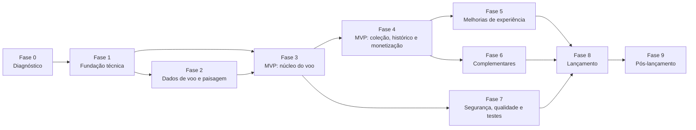

# Roadmap — Termi: Focus Flights

> Planejamento da evolução do produto em fases. Escopo e regras: [PRD.md](PRD.md). Decisões técnicas: [ARCHITECTURE.md](ARCHITECTURE.md).
> Última atualização: 19/11/2026.

Prioridades: **P0** bloqueia o lançamento · **P1** necessário para a v1 · **P2** desejável · **P3** pós-lançamento.

Regra: só marque `[x]` com evidência (PR mergeado, teste passando ou medição registrada). Nenhuma tarefa deste repositório está concluída ainda.

---

## Fase 0 — Diagnóstico do estado atual

**O que já existe (fora deste repositório):**

| Item | Evidência | Situação |
|---|---|---|
| Visão do produto (28 versões) | Doc "visao-do-produto.md" | Decisões consolidadas; pendências listadas no PRD §16 |
| Telas no Figma | Arquivo "Termi: Focus Flights", seções v2 (Onboarding, Início, Menu lateral, Estados do voo, Erros, Premium) | Desenhadas |
| Design system no Figma e em código | Página "Design System" (variáveis, componentes, 31 ícones); `src/ds` trazido do protótipo | Catálogo testado no M35 (build-1, 19/11): ajustes de sublinhado, linha do campo, Geist Grid e animações no PR "Ajustes do design system" |
| Protótipo técnico Android (base técnica) | `termi-prototipo`, build-8: janela Skia com renders do Blender e blocos Landsat, serviço de bordo, notificação fixa, avisos como alarme exato | Base confirmada no app: build-1 do `termi-app` (19/11) com a janela no mesmo desempenho e o aviso de pouso tocando com a tela bloqueada e o app fechado |
| Medições de bateria e memória | Doc "prototipo-tecnico.md" | ~1% em 25 min com tela bloqueada; limite de ~150 MB de textura |
| Validação dos dados de voo | Doc "validacao-dados-voos.md" (~17 h de coleta mundial) | Disponibilidade resolvida; previsão ruim acima de ~1h30 |
| Infraestrutura e políticas | Doc "infra-e-politicas.md" | Plano de R2, coletor, custos e riscos da Play |
| Animações do Termi | Arquivo Rive (nuvem), 5 animações e state machine testada | Falta exportar `.riv` e nomear o arquivo |
| Janela no Blender | Renders atrás da asa (3 luzes) | Faltam "Com asa" e "Asa e motor" |
| Medalhas | Portugal, EUA, Brasil, Reino Unido, Japão, França | Coleção atual de 13 países: faltam 7 e o verso; novos países em breve |

**Lacunas que bloqueiam decisões estruturais:** previsão de pouso para voos longos, aprovação da Play para alarmes exatos e bloqueio de apps.

---

## Fase 1 — Preparação e fundação técnica

- **Objetivo:** criar o projeto de produção sobre a base técnica do protótipo, já ajustada às regras do PRD.
- **Entregáveis:** projeto Expo rodando no aparelho com design system, janela e notificação fixa trazidos do protótipo; CI gerando build de teste.
- **Dependências:** nenhuma.
- **Prioridade:** P0.
- **Critérios de conclusão:** build de desenvolvimento abre no Samsung M35, mostra o catálogo do design system e uma janela de teste; tipos, lint e testes rodam no CI.

### Decisões a fechar
- [x] Aprovar Expo Router, expo-sqlite, Zustand e TanStack Query — aprovado pelo Alberto em 19/11/2026
- [x] Escolher backend de conta e sincronização (ADR-10) — Supabase, decidido em 19/11/2026; projeto criado pelo Alberto
- [x] Escolher a solução do globo (ADR-11) — globo em Skia com blocos da NASA GIBS, aprovado pelo Alberto em 19/11/2026 no build-5 (PR #5): blocos em 2 a 3 s, sem travamentos no M35
- [x] Decidir onde fica o código e o build: repositório `albertocolombara/termi-app` com APK pelo GitHub Actions — decidido em 19/11/2026
- [ ] Criar o repositório `albertocolombara/termi-app` no GitHub
- [ ] Definir o identificador do pacote de produção antes do primeiro envio à Play (até lá, um identificador provisório de desenvolvimento; o protótipo usa `com.albertocolombara.termiprototipo`)
- [ ] Resolver as inconsistências listadas no fim deste documento

### Tarefas
- [x] Criar o projeto Expo SDK 58 com TypeScript na estrutura proposta — PR #1
- [x] Configurar lint, `tsc --noEmit`, Jest (jest-expo) e scripts no `package.json` — PR #1
- [x] Configurar `app.config.ts` lendo as variáveis de `.env` — PR #1
- [x] Trazer `src/ds` (branch `design-system` do protótipo) e testar o catálogo no aparelho — PR #1, build-1 no M35
- [ ] Ajustes do catálogo após o teste: sublinhado nos botões, linha no campo de texto, Geist Pixel Grid, animações MD3, alça do bottom sheet, laranja internacional nos avisos — PR "Ajustes do design system" (falta testar no aparelho)
- [ ] Adicionar expo-blur para `Glass/Blur 12` — componente `Glass` no PR "Fase 1: vidro e teste do globo"; falta conferir no aparelho
- [x] Trazer `src/janela` (shader, blocos, geo) e `modules/screen-state`, mantendo o orçamento de ~150 MB de textura — PR #1; desempenho confirmado no M35 (build-1)
- [x] Ajustar ao PRD o que diverge no protótipo: pausa máxima de 5 min também no ciclo de 50 min e folga de 10 min (`agendaDePausas`, PR #1). O botão "Desembarcar" não veio para o app; o "Pousar antes" entra com a tela em voo (Fase 3)
- [x] Configurar i18n com pt-BR — PR #1
- [x] Criar o esquema SQLite inicial e as migrações — PR #1
- [x] CI: tipos, lint e testes nos PRs e na `main`; APK sob demanda e na `main` — PR #1 (build-1 em 23 min)

---

## Fase 2 — Dados de voo e paisagem

- **Objetivo:** garantir dados confiáveis e servidos de forma escalável.
- **Entregáveis:** coletor de produção publicando JSON por região no R2; previsão de pouso revalidada; blocos do mundo no R2.
- **Dependências:** contrato do cache (ARCHITECTURE §9). Pode correr em paralelo à Fase 1.
- **Prioridade:** P0.
- **Critérios de conclusão:** cache atualizado a cada 10–20 min por 7 dias sem falha; previsão com ≥ 80% dentro de ±10 min em todas as faixas oferecidas; blocos acessíveis pela CDN.

- [ ] Completar a medição de 24 h de disponibilidade (faltam 11h–16h)
- [ ] Corrigir o cálculo de pouso para voos longos (velocidade de cruzeiro, distância pela rota, vento) e medir de novo
- [ ] Definir quais faixas de duração entram na v1 conforme o resultado
- [ ] Fechar o contrato do JSON por região (versão, `coletadoEm`, campos)
- [ ] Mapear companhia → país da bandeira (base de companhias)
- [ ] Guardar a trilha do dia anterior para o "voo de ontem"
- [ ] Coletor no GitHub Actions gravando no R2 durante o desenvolvimento (decidido em 19/11/2026); onde ele roda em produção (Oracle grátis ou Workers pago) fica para a Fase 8
- [ ] Criar a conta da Cloudflare e o bucket R2 no plano grátis (Alberto) e as chaves no GitHub
- [ ] Configurar domínio próprio e cache no R2 (até lá, endereço r2.dev de desenvolvimento)
- [ ] Gerar e enviar os blocos do mundo (~13 GB; avaliar corte para < 10 GB)
- [ ] Gerar texturas comprimidas (KTX2/Basis) [Proposta]
- [ ] Monitorar o uso da cota do adsb.lol

---

## Fase 3 — MVP: núcleo do voo

- **Objetivo:** o usuário consegue escolher um tempo, embarcar num voo real, focar e pousar.
- **Entregáveis:** UC-02 a UC-06 e UC-08 (sem loja) funcionando no aparelho.
- **Dependências:** Fases 1 e 2.
- **Prioridade:** P0.
- **Critérios de conclusão:** critérios de aceitação desses casos de uso atendidos; aviso de pouso confirmado com tela bloqueada e app fechado no Android 14+.

### Domínio (com testes)
- [ ] Máquina de estados da sessão guiada pelo relógio
- [ ] Agenda de pausas (RN-05 a RN-07, com os exemplos do PRD)
- [ ] Elegibilidade e ordenação dos voos (RN-02)
- [ ] Projeção de posição e lugar sobrevoado
- [ ] Rendimentos de pouso e de pouso antecipado (RN-08, RN-10)
- [ ] Livro-caixa do saldo

### Telas e serviços
- [ ] Dial (15 min–6 h; faixa premium marcada)
- [ ] Painel de partidas com filtros de região e cauda com bandeira
- [ ] Sem voo: tempos próximos; dados fora do ar: voo de ontem
- [ ] Cartão de embarque com motivo da viagem
- [ ] Caminho rápido no dial
- [ ] Tela de embarque com etapas reais, download de blocos e "Embarcar com o globo"
- [ ] Tela em voo: globo, janela, painel inferior, mensagem de boas-vindas
- [ ] Sons de fundo e avisos por fase (áudio em segundo plano)
- [ ] Serviço de bordo com avisos agendados como alarme exato
- [ ] Notificação fixa com contagem
- [ ] Pousar antes com confirmação
- [ ] Estados E1–E7, sem sinal, sem internet, em espera
- [ ] Tela de pouso com carimbo e rendimentos
- [ ] Desenhar a paisagem pela thread de interface (Reanimated) em vez de timer JS

---

## Fase 4 — MVP: coleção, histórico, monetização e onboarding

- **Objetivo:** completar a v1 descrita no PRD §12.
- **Entregáveis:** UC-01, UC-08 (loja), UC-09 a UC-16 (exceto UC-07).
- **Dependências:** Fase 3; backend de sincronização decidido.
- **Prioridade:** P0/P1.
- **Critérios de conclusão:** fluxo completo do onboarding ao souvenir na mala; compra de teste na Play com restauração; progresso restaurado após reinstalar.

- [ ] Onboarding (5 telas) com permissões explicadas e "Alarmes e lembretes"
- [ ] Início com o Termi em Rive (`pensando`, `novoVoo`) e transição da mala
- [ ] Menu lateral e Perfil
- [ ] Catálogo da coleção remoto e versionado (13 países; novos sem nova versão do app) [Proposta]
- [ ] Loja do destino com prévia na mala e limite de 3 souvenirs na econômica
- [ ] Sua mala e vitrine 3D (validar react-native-filament: peso e memória)
- [ ] Passaporte
- [ ] Status de viajante e recompensas
- [ ] Diário de bordo com filtro e detalhe
- [ ] Estatísticas (semana; mês e ano na primeira classe)
- [ ] RevenueCat: produtos, direitos, compra, restauração
- [ ] Paywall P1, oferta de boas-vindas (fim do onboarding e após o 3º voo), compra concluída P4, gerenciar P5
- [ ] Gatilhos do paywall (RN-20): todo recurso da primeira classe abre o paywall ao toque, dentro e fora do voo
- [ ] Vistas da janela por plano; sons premium
- [ ] Backup do progresso e conta opcional
- [ ] Ajustes (M5), Sobre o Termi (M6), Ajuda e sugestões (M7)
- [ ] Exportar e apagar dados
- [ ] Estados vazios e aviso de avisos desligados no Início

---

## Fase 5 — Melhorias de experiência

- **Objetivo:** acabamento visual e de conteúdo.
- **Entregáveis:** todas as vistas e medalhas da v1; animações e recompensas finais.
- **Dependências:** Fase 4.
- **Prioridade:** P1.
- **Critérios de conclusão:** nenhuma vista ou medalha da v1 usa placeholder.

- [ ] Renderizar "Com asa" e "Asa e motor" nos três horários, com moldura grafite
- [ ] Medalhas dos 7 países restantes dos 13 (falta a referência do Uruguai) e o verso padrão
- [ ] Definir e produzir os próximos países da coleção
- [ ] Desenhar os 7 adesivos do Termi, os carimbos de nível e a medalha rara do Nômade
- [ ] Exportar o `.riv` final (nomear o arquivo; trocar o ícone provisório das moedas)
- [ ] Ajuste de cor da terra por estação; variar o lado do sol na asa
- [ ] Definir as medalhas do balão de pensamento e a animação do Termi Premium
- [ ] Revisão de microcopy com a terminologia fixa

---

## Fase 6 — Funcionalidades complementares

- **Objetivo:** recursos da primeira classe que dependem de aprovação ou definição.
- **Entregáveis:** bloqueio de apps (se aprovado), widgets (se definidos).
- **Dependências:** Fase 4; teste na Play.
- **Prioridade:** P1 (bloqueio) / P2 (widgets, lembrete).
- **Critérios de conclusão:** recurso aprovado pela Play e incluído no paywall; ou retirado da v1 com o paywall ajustado.

- [ ] Teste do bloqueio de apps na Play ("Acesso ao uso" + `specialUse`, sem Acessibilidade e sem QUERY_ALL_PACKAGES)
- [ ] Implementar UC-07 se aprovado; senão, remover o slide do paywall
- [ ] Definir e implementar widgets
- [ ] Lembrete de voo diário (desligado por padrão)

---

## Fase 7 — Segurança, qualidade e testes

- **Objetivo:** confiabilidade antes do lançamento. Começa junto com a Fase 3 e segue contínua.
- **Entregáveis:** suíte de testes, roteiro de teste em aparelho, monitoramento de erros, conformidade com LGPD.
- **Dependências:** Fase 3.
- **Prioridade:** P0.
- **Critérios de conclusão:** roteiro de aparelho aprovado no M35 e num Android mais fraco; zero caminho conhecido que perde progresso.

- [ ] Testes unitários de todo `src/domain`
- [ ] Testes de componente nas telas com regras (paywall, pousar antes)
- [ ] E2E (Maestro [Proposta]): onboarding → caminho rápido → pousar antes; compra de teste
- [ ] Roteiro de aparelho: aviso de pouso com tela bloqueada, reinício durante o voo, bateria, fps, memória
- [ ] Teste num Android mais fraco que o M35
- [ ] Monitoramento de erros sem dados pessoais (Sentry [Proposta])
- [ ] Métricas de produto sem SDK publicitário (ferramenta [Pendente])
- [ ] Auditoria de acessibilidade (leitor de tela, contraste, reduzir movimento, fonte ampliada)
- [ ] Revisão de permissões e de segredos
- [ ] Política de privacidade e termos de uso

---

## Fase 8 — Preparação para lançamento

- **Objetivo:** publicar na Play Store no Brasil.
- **Entregáveis:** app em teste fechado e depois em produção.
- **Dependências:** Fases 5, 6 e 7.
- **Prioridade:** P0.
- **Critérios de conclusão:** app aprovado e publicado; compras reais funcionando; créditos e avisos legais completos.

- [ ] Confirmar o nome com agente de propriedade industrial; registrar marca mista (classes 9 e 41)
- [ ] Tirar o coletor do GitHub Actions: Oracle Cloud grátis (configuração automática) ou Cloudflare Workers pago (US$ 5/mês), antes do teste fechado
- [ ] Definir o identificador do pacote de produção
- [ ] Play Console: declaração de alarmes exatos (tentar USE_EXACT_ALARM com argumento de timer); `specialUse` se houver bloqueio
- [ ] Produtos e preços no Play Console e no RevenueCat (R$ 14,90 / R$ 89,90 / R$ 179,90; oferta R$ 59,90)
- [ ] Ficha da loja, capturas e vídeo
- [ ] Avisar o adsb.lol da ida à produção; créditos ODbL no app
- [ ] Preencher a data de acesso na citação do GMIS
- [ ] Teste fechado com estudantes (público principal)
- [ ] Lançamento em produção

---

## Fase 9 — Evolução pós-lançamento

- **Objetivo:** crescer a partir da validação no Brasil.
- **Prioridade:** P3.

- [ ] Medir conversão (meta 2–5%), distribuição de planos e retenção
- [ ] Teste de dois preços na Play via RevenueCat
- [ ] Inglês e expansão internacional (preços acima de US$ 3,99/mês)
- [ ] iOS (Live Activity, Screen Time/Family Controls)
- [ ] Novos países periódicos e moedas de cidade
- [ ] Limite de 8 h, se houver demanda
- [ ] Receptor ADS-B próprio; coletor em Cloudflare Workers
- [ ] Voar com amigos no mesmo voo
- [ ] "Voo de companhia" (não conta como foco)
- [ ] Loja geral de colecionáveis

---

## Inconsistências a resolver (entrada da Fase 1)

| # | Inconsistência | Onde | Recomendação |
|---|---|---|---|
| 1 | Moedas do balão de pensamento "prata e bronze" (Rive) × níquel e cobre (coleção) | Arquivo Rive × visao-do-produto | Alinhar ao níquel e cobre |
| 2 | Laranja do Termi: sem variável no Figma; `#F28C28` no ícone e na notificação do protótipo × `orange/500 #FF9F1C` | Figma × protótipo | Criar a variável `brand/termi` |
| 3 | Voos de até 6 h oferecidos × previsão com 35% de acerto em 3–6 h | visao-do-produto × validacao-dados-voos | Condicionar faixas à revalidação (Fase 2) |
| 4 | Frequência do cache "10 a 20 min" × coleta atual de cada região a cada 30 min | visao-do-produto × validacao-dados-voos | Ajustar o rodízio dentro da cota de 1.000 chamadas/dia (9 regiões a cada 15 min = 864 chamadas) |

**Resolvidas em 19/11/2026:**

- Tempo de foco mínimo: **15 min**.
- Pausa do serviço de bordo: **no máximo 5 min**, no intervalo de 25 ou de 50 min.
- Folga mínima depois da pausa: **10 min** de voo (não há pausa se sobrar menos que isso até o pouso).
- Coleção: **13 países por enquanto**, com novos países em pouco tempo. Os textos da visão do produto que falam em 11 ficam desatualizados.
- Regras de produto do protótipo que divergem do PRD ("Desembarcar", pausa de 10 min no ciclo de 50) não contam como inconsistência: o código é ajustado ao PRD na Fase 1. A base técnica do protótipo continua valendo.
