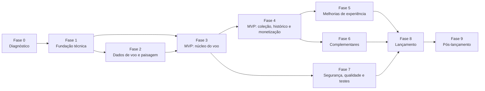

# Roadmap — Termi: Focus Flights

> Planejamento da evolução do produto em fases. Escopo e regras: [PRD.md](PRD.md). Decisões técnicas: [ARCHITECTURE.md](ARCHITECTURE.md).
> Última atualização: 25/11/2026.

Prioridades: **P0** bloqueia o lançamento · **P1** necessário para a v1 · **P2** desejável · **P3** pós-lançamento.

Regra: só marque `[x]` com evidência (PR mergeado, teste passando ou medição registrada).

**Situação em 25/11/2026 (tarde):** núcleo do voo da Fase 3 conferido pelo Alberto na build-61 e PRs #50 e #51 mergeados; restam itens menores da Fase 3 (abaixo) e começa a Fase 4. **Antes:** Fase 1 concluída; Fase 2 concluída no essencial (falta o domínio próprio e os 7 dias de cache sem falha, que fecham em 27/11 se não houver falha); **Fase 3 em andamento**, com o núcleo do voo usado pelo Alberto no M35 desde a build-26 (última: build-54). Telas v3 (PR #50) e correções dos builds 48 a 53 (PR #51) abertas, em teste no aparelho. Partes da Fase 4 já começaram nas telas v3. Pendências da Fase 3 no fim da seção dela.

---

## Fase 0 — Diagnóstico do estado atual

**O que já existe (fora deste repositório):**

| Item | Evidência | Situação |
|---|---|---|
| Visão do produto (28 versões) | Doc "visao-do-produto.md" | Decisões consolidadas; pendências listadas no PRD §16 |
| Telas no Figma | Arquivo "Termi: Focus Flights", seções v2 (Onboarding, Início, Menu lateral, Estados do voo, Erros, Premium) | Desenhadas |
| Design system no Figma e em código | Página "Design System" (variáveis, componentes, 31 ícones); `src/ds` trazido do protótipo | Catálogo testado no M35 (build-1, 19/11): ajustes de sublinhado, linha do campo, Geist Grid e animações no PR "Ajustes do design system" |
| Protótipo técnico Android (base técnica) | `termi-prototipo`, build-8: janela Skia com renders do Blender e blocos Landsat, serviço de bordo, notificação fixa, avisos como alarme exato | Base confirmada no app: build-1 do `termi-app` (19/11) com a janela no mesmo desempenho e o aviso de pouso tocando com a tela bloqueada e o app fechado |
| Medições de bateria e memória | Doc "prototipo-tecnico.md" | ~1% em 25 min com tela bloqueada; limite de ~150 MB de textura |
| Validação dos dados de voo | Doc "validacao-dados-voos.md" e coletor `voo-ao-vivo-teste` (24 h, 1.247 pousos) | Disponibilidade resolvida; previsão imprecisa acima de ~1h30, resolvida pela regra do tempo do usuário (RN-09) |
| Infraestrutura e políticas | Doc "infra-e-politicas.md" | Plano de R2, coletor, custos e riscos da Play |
| Animações do Termi | Arquivo Rive (nuvem), 5 animações e state machine testada | Falta exportar `.riv` e nomear o arquivo |
| Janela no Blender | Renders v3 (janela e asa realistas, 3 luzes) e miniaturas | "Com asa" e "Asa e motor" fora do lançamento (24/11/2026); persiana com animação na build-54 |
| Medalhas | Portugal, EUA, Brasil, Reino Unido, Japão, França | Coleção atual de 13 países: faltam 7 e o verso; novos países em breve |

**Lacunas que bloqueiam decisões estruturais:** aprovação da Play para alarmes exatos e bloqueio de apps. (A previsão de pouso dos voos longos deixou de bloquear em 19/11/2026: RN-09.)

---

## Fase 1 — Preparação e fundação técnica

- **Objetivo:** criar o projeto de produção sobre a base técnica do protótipo, já ajustada às regras do PRD.
- **Entregáveis:** projeto Expo rodando no aparelho com design system, janela e notificação fixa trazidos do protótipo; CI gerando build de teste.
- **Dependências:** nenhuma.
- **Prioridade:** P0.
- **Critérios de conclusão:** build de desenvolvimento abre no Samsung M35, mostra o catálogo do design system e uma janela de teste; tipos, lint e testes rodam no CI.

### Decisões a fechar
- [x] Aprovar Expo Router, expo-sqlite, Zustand e TanStack Query — aprovado pelo Alberto em 19/11/2026
- [x] Escolher backend de conta e sincronização (ADR-10) — Supabase, decidido em 19/11/2026; projeto criado pelo Alberto
- [x] Escolher a solução do globo (ADR-11) — globo em Skia com blocos da NASA GIBS, aprovado pelo Alberto em 19/11/2026 no build-5 (PR #5): blocos em 2 a 3 s, sem travamentos no M35
- [x] Decidir onde fica o código e o build: repositório `albertocolombara/termi-app` com APK pelo GitHub Actions — decidido em 19/11/2026
- [x] Criar o repositório `albertocolombara/termi-app` no GitHub — criado pelo Alberto em 19/11/2026
- [ ] Definir o identificador do pacote de produção — adiado pelo Alberto para a preparação do lançamento (Fase 8); até lá, `com.albertocolombara.termiapp.dev`
- [x] Resolver as inconsistências listadas no fim deste documento — as que bloqueavam a Fase 1 foram resolvidas; as restantes (#1, #3, #4) ficam com a fase indicada na tabela

### Tarefas
- [x] Criar o projeto Expo SDK 58 com TypeScript na estrutura proposta — PR #1
- [x] Configurar lint, `tsc --noEmit`, Jest (jest-expo) e scripts no `package.json` — PR #1
- [x] Configurar `app.config.ts` lendo as variáveis de `.env` — PR #1
- [x] Trazer `src/ds` (branch `design-system` do protótipo) e testar o catálogo no aparelho — PR #1, build-1 no M35
- [x] Ajustes do catálogo após o teste: sublinhado nos botões, linha no campo de texto, Geist Pixel Grid, animações MD3, alça do bottom sheet, laranja internacional nos avisos — PR #2, aprovado pelo Alberto no build-4. Selos de primeira classe novos no PR #7 (build-6)
- [x] Adicionar expo-blur para `Glass/Blur 12` — componente `Glass`, aprovado pelo Alberto no M35 em 19/11/2026
- [x] Trazer `src/janela` (shader, blocos, geo) e `modules/screen-state`, mantendo o orçamento de ~150 MB de textura — PR #1; desempenho confirmado no M35 (build-1)
- [x] Ajustar ao PRD o que diverge no protótipo: pausa máxima de 5 min também no ciclo de 50 min e folga de 10 min (`agendaDePausas`, PR #1). O botão "Desembarcar" não veio para o app; o "Pousar antes" entra com a tela em voo (Fase 3)
- [x] Configurar i18n com pt-BR — PR #1
- [x] Criar o esquema SQLite inicial e as migrações — PR #1
- [x] CI: tipos, lint e testes nos PRs e na `main`; APK sob demanda e na `main` — PR #1 (build-1 em 23 min)

---

## Fase 2 — Dados de voo e paisagem

- **Objetivo:** garantir dados confiáveis e servidos de forma escalável.
- **Entregáveis:** coletor de produção publicando JSON por região no R2; previsão de pouso revalidada; blocos do mundo no R2.
- **Dependências:** contrato do cache (ARCHITECTURE §9). Pode correr em paralelo à Fase 1.
- **Prioridade:** P0.
- **Critérios de conclusão:** cache atualizado a cada 10–20 min por 7 dias sem falha; previsão medida em todas as faixas oferecidas (≥ 80% dentro de ±10 min é meta de qualidade, não de bloqueio, desde a RN-09 de 19/11/2026); blocos acessíveis pela CDN.

- [x] Completar a medição de 24 h de disponibilidade — 19/11/2026, `voo-ao-vivo-teste`: voos em todas as faixas a qualquer hora (mínimo ~25 voos de 6 h+ no mundo, madrugada UTC). Uma resposta vazia do adsb.lol (19/11, 23:40 UTC) passou a ser ignorada na publicação (PR #2 do coletor)
- [x] Medir de novo a previsão de pouso — 1.247 pousos: até 1h30 acerta 82–84% dentro de ±10 min; voos de 3 h+ ficam em 17–24% e um modelo novo não melhorou (ARCHITECTURE §13). Decisão do Alberto (19/11): o tempo do usuário é fixo, com os estados Em espera e Em solo (PRD RN-09)
- [x] Definir quais faixas de duração entram na v1 conforme o resultado — todas, de 15 min a 6 h, com o tempo do usuário fixo (RN-09); decidido pelo Alberto em 19/11/2026
- [x] Fechar o contrato do JSON por região (versão, `coletadoEm`, campos) — ARCHITECTURE §9, aprovado pelo Alberto em 19/11/2026; publicado no R2 pelo coletor
- [x] Mapear companhia → país da bandeira (base de companhias) — OpenFlights (ODbL) + 15 correções manuais; 99% dos voos acompanhados (PR #3 do coletor, 20/11/2026)
- [x] Guardar a trilha do dia anterior para o "voo de ontem" — histórico por faixa de 20 min no R2 (PR #4 do coletor, 20/11/2026); o uso no app entra com a RN-12
- [x] Coletor no GitHub Actions gravando no R2 durante o desenvolvimento (decidido em 19/11/2026; `voos/<regiao>.json` e `voos/indice.json`); onde ele roda em produção (Oracle grátis ou Workers pago) fica para a Fase 8
- [x] Criar a conta da Cloudflare e o bucket R2 no plano grátis (Alberto) e as chaves no GitHub — bucket `termi-dados`, publicação desde 20/11/2026 00:20 UTC (PR #1 do coletor)
- [ ] Configurar domínio próprio e cache no R2 (até lá, endereço r2.dev de desenvolvimento)
- [x] Gerar e enviar os blocos do mundo — toda a terra menos a Antártida (decisão do Alberto, 19/11/2026): 259.236 blocos, ~7,8 GB no R2 em 20/11/2026 (workflow "Blocos de paisagem" do coletor, PR #5; ARCHITECTURE §19)
- [x] Trocar a paisagem pelo Sentinel-2 (ESA WorldCover 2021) e as luzes das cidades pela camada `l9` (decisão do Alberto, 20–21/11/2026; o R2 fica nos 10 GB grátis) — PR #10 e #11 do coletor: 256.922 blocos, ~8,0 GB, sem erros; rodada v2 da cor (mar no Blue Marble) gerada em 21/11/2026. O uso no app está no PR #47 (em teste)
- [x] Apagar do R2 os blocos do Landsat que não foram regravados — 6.036 `w10` e 1.414 `w8` (0,15 GB), modo "limpar" do workflow disparado pelo Alberto em 21/11/2026 (log confirma)
- [ ] Apagar a camada `i9` (0,11 GB) quando nenhum app em teste a usar
- [x] Blocos do globo no R2 (Blue e Black Marble em WebP, níveis 1 a 7, 149 MB) — PR #46 e workflow "Blocos do globo" do coletor, 20/11/2026; 17 a 29 MB por voo medidos pelo Alberto na build-38 antes da troca
- [x] Nuvens reais do mundo no R2, atualizadas a cada 3 h (VIIRS, ~22 MB fixos) — PR #40 e workflow "Nuvens" do coletor, 20/11/2026
- [x] Lofi no R2 (31 faixas CC0, 64 MB, fora do APK) — PR #43 e workflow "Música" do coletor, 20/11/2026
- [ ] Gerar texturas comprimidas (KTX2/Basis) [Proposta]
- [ ] Monitorar o uso da cota do adsb.lol — hoje ~864 chamadas por dia (limite de 1.000 com a chave), visíveis no log de cada coleta
- [ ] Cache atualizado a cada 10–20 min por 7 dias sem falha (em medição desde 20/11/2026 00:20 UTC)

---

## Fase 3 — MVP: núcleo do voo

- **Objetivo:** o usuário consegue escolher um tempo, embarcar num voo real, focar e pousar.
- **Entregáveis:** UC-02 a UC-06 e UC-08 (sem loja) funcionando no aparelho.
- **Dependências:** Fases 1 e 2.
- **Prioridade:** P0.
- **Situação:** em andamento desde 20/11/2026.
- **Critérios de conclusão:** critérios de aceitação desses casos de uso atendidos; aviso de pouso confirmado com tela bloqueada e app fechado no Android 14+.

### Domínio (com testes)
- [x] Tempo de foco: mínimo de 15 min, econômica até 3 h, primeira classe até 6 h (`src/domain/sessao/duracao.ts`, PR #1)
- [x] Máquina de estados da sessão guiada pelo relógio, com Em espera (RN-09a) e Em solo (RN-09b) — `sessao/estado.ts`, PR #17
- [x] Agenda de pausas (RN-05 a RN-07, com os exemplos do PRD) — `src/domain/sessao/pausas.ts` com testes, PR #1
- [x] Elegibilidade e ordenação dos voos (RN-02), com tempos próximos — `voos/elegibilidade.ts`, PR #17
- [x] Projeção de posição e milhas voadas — `voos/projecao.ts`, PR #17
- [x] ~~Lugar sobrevoado (GeoNames)~~ — retirado por decisão do Alberto (25/11/2026): pouco relevante para o usuário
- [x] Rendimentos de pouso e de pouso antecipado (RN-08, RN-10), incluindo os minutos de "Continuar até o pouso" (RN-09a) — `sessao/rendimentos.ts`, PR #17
- [x] Livro-caixa do saldo — `saldo/livroCaixa.ts`, PR #17

### Dados
- [x] Cliente do cache de voos: ler `voos/indice.json` e as regiões do R2 (contrato da ARCHITECTURE §9), com TanStack Query — `data/voos`, PR #18 (falta conferir no aparelho pela tela "Voos do cache")
- [x] Voo de ontem: ler `historico/{regiao}/{HHMM}.json` quando os dados ao vivo estão fora do ar (RN-12) — `data/voos`, PR #18
- [x] Janela lendo os blocos do R2 (`blocos/{camada}/{linha}/{coluna}.webp`) no lugar dos pacotes do protótipo, baixados no embarque — download e leitura no PR #23; a janela segue a rota do voo da sessão no PR #24; só a próxima 1 h da rota, conferida a cada 10 min, no PR #45 (consumo de dados medido pelo Alberto na build-38); pacotes do protótipo fora do APK (21 MB) e tela de teste da janela baixando do R2 no PR "Tira os pacotes do protótipo" (25/11/2026)

### Telas e serviços
- [x] Telas de Em espera, Continuando até o pouso e Em solo no Figma — 20/11/2026, seção "Estados do voo · v2"; barra de rota como componente com progresso (DESIGN.md)
- [x] Dial (15 min–6 h; faixa premium marcada) — `features/voo/DialDeTempo.tsx` e seletor numérico, PR #20; Termi curioso no PR #35 e dica menor no PR #42, ajustes pedidos pelo Alberto depois de usar no M35
- [x] Painel de partidas com filtros de região e cauda com bandeira — PR #20; no PR #27 as caudas viraram PNG (o SVG por linha derrubava o app ao rolar a lista no build-17); letreiro no PR #34 e nome da cidade correndo no PR #44
- [x] Sem voo: tempos próximos; dados fora do ar: voo de ontem — PR #18 e #20
- [x] Cartão de embarque com motivo da viagem — cartão no PR #20; motivo da viagem (03b) com regras em `sessao/motivo.ts` no PR #22; impressão ao abrir no PR #33 e "Data" no lugar de "Terminal" no PR #38, pedidos pelo Alberto depois de usar no M35
- [x] Caminho rápido no dial — "Embarcar no voo mais próximo" vai direto ao embarque, sem motivo da viagem (UC-03), PR #23
- [x] Tela de embarque com etapas reais, download de blocos e "Embarcar com o globo" — `features/voo/TelaEmbarque.tsx`, PR #23: grava a sessão e o motivo numa transação, agenda os avisos e mostra a notificação fixa; Termi do Rive na esteira no PR #32; textos cortados corrigidos no PR #37 (retorno da build-27 no M35)
- [x] Tela em voo: globo, janela, painel inferior, mensagem de boas-vindas — PR #24: janela e globo seguindo a rota do voo da sessão, painéis superior e inferior, barra de rota com o avião andando, próximo serviço de bordo; aviso de boas-vindas no PR #27; vista da janela (04E) no PR #28, com Só a janela, Asa completa e Sem moldura (Com asa e Asa e motor esperam o render do Blender); botão e folha de som (04D) no PR #29; ajustes do voo no PR #38 e #41; nuvens reais e altitude real no PR #40; usada pelo Alberto no M35 desde a build-26 (retornos nos PR #36 a #46)
- [x] Sons de fundo em segundo plano — sons (motores, ruído branco, cabine, chuva) no PR #29; com a tela bloqueada no PR #30; sem o controle de mídia do Android e com fade no embarque no PR #39 (testado pelo Alberto na build 31); voo de cruzeiro grátis, motores na primeira classe e lofi em streaming no PR #43
- [x] Conferir o lofi no aparelho com a tela bloqueada por um voo inteiro — conferido pelo Alberto (25/11/2026, build-61), sem precisar de `WAKE_LOCK`
- [x] Avisos por fase — decisão do Alberto (25/11/2026): só um aviso, o da comissária no pouso, para não tirar o foco; tocado pelo app com o som de fundo baixando antes (build-61, conferido pelo Alberto)
- [x] Serviço de bordo com avisos agendados como alarme exato — ciclo completo e sinal de cintos conferidos pelo Alberto com a tela bloqueada (25/11/2026, build-61); avisos agendados no embarque (PR #23; no horário num voo curto na build-6, ARCHITECTURE §15); E2 (pausa em andamento com contagem e "Voltar ao foco", que cancela o aviso de fim) e E1 ("De volta ao foco") no PR #36; falta conferir no aparelho o ciclo completo com a tela bloqueada e o app fechado
- [x] Notificação fixa com contagem — mostrada no embarque (PR #23); é a notificação do serviço do som desde o PR #39 (testado pelo Alberto na build 31)
- [x] Pousar antes com confirmação — E3 e E7, encerramento numa transação (sessão, crédito e carimbo), PR #25 (falta conferir no aparelho)
- [x] Estados E1–E7, sem sinal, sem internet, em espera — conferidos pelo Alberto (25/11/2026, build-61). Em espera só aparece quando o destino está numa das áreas lidas pelo coletor; manter, trocar por uma informação na tela de pouso ou tirar fica para decidir (análise de 25/11/2026). prontos: E1, E2 (PR #36), E3, E6, E7 (PR #25); regras de Em espera e Em solo no domínio (PR #17) e telas no Figma; avisos de sem sinal do radar, sem internet e "radar de volta", com o radar ciente da área do coletor, no PR #51 (builds 51 a 53); E5 Em espera e E5b Continuando até o pouso no PR #51 (build-55, falta testar no aparelho; a tela E5 é proposta no Figma v3). O E8 Em solo saiu da Fase 3 (decisão do Alberto em 25/11/2026) e está na Fase 5
- [x] Tela de pouso com carimbo e rendimentos — E6, PR #25; o botão da loja do destino entra com a loja (Fase 4)
- [x] Desenhar a paisagem pela thread de interface (Reanimated) em vez de timer JS — PR #37 (build-28): `useFrameCallback` + `useDerivedValue`, sem o teto de ~21 fps do timer; 30 fps opcional nos Ajustes (PR #42)
- [ ] Medir 30 fps no M35 e num Android mais fraco (bateria, temperatura, memória) antes de decidir se fica
- [ ] Paisagem do Sentinel-2, luzes das cidades novas e globo até 61 m — PR #47 mergeado; usado pelo Alberto nas builds 48 a 53 (consumo de dados medido); falta medir memória e quadros da janela e do globo no zoom máximo

### Pendente na Fase 3 (25/11/2026)

Concluídos em 25/11/2026 (conferidos pelo Alberto na build-61): testes e merge dos PRs #50 e #51, estados do voo com Em espera, ciclo do serviço de bordo e lofi com a tela bloqueada, e o aviso de pouso da comissária no lugar dos avisos por fase.

1. Medir no M35 e num Android mais fraco: 30 fps (bateria, temperatura) e memória da janela com a persiana.
2. Fora do app, mas da Fase 2: domínio próprio no R2, 7 dias de cache sem falha e apagar a `i9`.

---

## Fase 4 — MVP: coleção, histórico, monetização e onboarding

- **Objetivo:** completar a v1 descrita no PRD §12.
- **Entregáveis:** UC-01, UC-08 (loja), UC-09 a UC-16 (exceto UC-07).
- **Dependências:** Fase 3; backend de sincronização decidido.
- **Prioridade:** P0/P1.
- **Critérios de conclusão:** fluxo completo do onboarding ao souvenir na mala; compra de teste na Play com restauração; progresso restaurado após reinstalar.

- [ ] Onboarding (5 telas) com permissões explicadas e "Alarmes e lembretes"
- [ ] Início com o Termi em Rive (`pensando`, `novoVoo`) e transição da mala — **trocado pelo Início v3** (Figma, 24/11/2026): globo de rotas, resumo do diário, último voo com "Repetir" e a marca Plus no PR "Telas v3" (falta testar no aparelho)
- [ ] Menu lateral e Perfil — menu lateral v3 (Econômica e Plus) com o status de viajante no PR "Telas v3" (falta testar no aparelho; "Criar conta" ainda mostra "em breve")
- [x] Catálogo da coleção remoto e versionado (13 países; novos sem nova versão do app) — aprovado pelo Alberto em 25/11/2026; publicado no R2 pelo coletor (PR #17 do voo-ao-vivo-teste) e lido pelo app com cópia embutida (PR "Catálogo remoto"); a mala já usa
- [ ] Loja do destino com prévia na mala e limite de 3 souvenirs na econômica
- [ ] Sua mala e vitrine 3D (validar react-native-filament: peso e memória) — teste no PR #55 (build-66): o Filament soma 8,6 MB ao APK universal (69,7 → 78,3 MB); falta abrir a tela de teste no M35 e medir memória e fluidez, depois repetir com as medalhas reais em GLB
- [ ] Passaporte — M2 v3 com os carimbos de pouso no PR "Telas v3" (falta testar no aparelho)
- [ ] Status de viajante e recompensas
- [ ] Diário de bordo com filtro e detalhe — M3 e M3b v3 no PR "Telas v3" (falta testar no aparelho)
- [ ] Estatísticas — M4 v3 (dia a ano para todos, globo do período, "Por categoria" no Plus) no PR "Telas v3"; faltam os blocos de desempenho depois de "Por categoria" (ainda não desenhados)
- [ ] RevenueCat: produtos, direitos, compra, restauração
- [ ] Paywall P1, oferta de boas-vindas (fim do onboarding e após o 3º voo), compra concluída P4, gerenciar P5 — P1 visual no PR #36 (planos, condições, carrossel com os benefícios que já existem; etiqueta "Economize" corrigida no PR #44), sem compra: em builds de teste o botão liga a primeira classe de teste; o Alberto vai ajustar o visual no Figma; faltam RevenueCat, Restaurar compras, Termos e Privacidade
- [ ] Gatilhos do paywall (RN-20): todo recurso da primeira classe abre o paywall ao toque, dentro e fora do voo — vistas e sons com cadeado abrem o P1 (em voo e nos Ajustes) no PR #36; faltam os recursos que ainda não existem
- [ ] Vistas da janela por plano; sons premium — sons premium (motores, cabine, chuva, lofi) e vistas com cadeado no PR #36 e #43; vistas do lançamento (Janela, Asa e Sem moldura) com as renders v3 na build-53, ainda não conferidas no aparelho; "Com asa" e "Asa e motor" saíram (24/11/2026)
- [ ] Backup do progresso e conta opcional
- [ ] Ajustes (M5), Sobre o Termi (M6), Ajuda e sugestões (M7) — Ajustes parcial no PR #31 (serviço de bordo e intervalo, som de fundo, aviso de pouso, economia de bateria, qualidade da janela, classe de teste) e janela a 30 fps no PR #42, aberto por uma engrenagem no Início até o menu lateral existir; créditos do M6 atualizados no Figma com ESA WorldCover e OpenStreetMap (21/11/2026), tela ainda não feita no app; faltam os itens que dependem de recursos ainda não feitos
- [ ] Exportar e apagar dados
- [ ] Estados vazios e aviso de avisos desligados no Início

---

## Fase 5 — Melhorias de experiência

- **Objetivo:** acabamento visual e de conteúdo.
- **Entregáveis:** todas as vistas e medalhas da v1; animações e recompensas finais.
- **Dependências:** Fase 4.
- **Prioridade:** P1.
- **Critérios de conclusão:** nenhuma vista ou medalha da v1 usa placeholder.

- [ ] Estado E8 Em solo na tela em voo e render da janela com o avião no solo (taxiando ou no portão) **[Pendente]** — saiu da Fase 3 por decisão do Alberto em 25/11/2026
- [ ] Renderizar "Com asa" e "Asa e motor" nos três horários (fora do lançamento desde 24/11/2026; volta se o Alberto decidir)
- [ ] Medalhas dos 7 países restantes dos 13 (falta a referência do Uruguai) e o verso padrão
- [ ] Definir e produzir os próximos países da coleção
- [ ] Desenhar os 7 adesivos do Termi, os carimbos de nível e a medalha rara do Nômade
- [ ] Exportar o `.riv` final (nomear o arquivo; trocar o ícone provisório das moedas)
- [ ] Ajuste de cor da terra por estação; variar o lado do sol na asa
- [ ] Definir as medalhas do balão de pensamento e a animação do Termi Premium
- [ ] Revisão de microcopy com a terminologia fixa

---

## Fase 6 — Funcionalidades complementares

- **Objetivo:** recursos da primeira classe que dependem de aprovação ou definição.
- **Entregáveis:** bloqueio de apps (se aprovado), widgets (se definidos).
- **Dependências:** Fase 4; teste na Play.
- **Prioridade:** P1 (bloqueio) / P2 (widgets, lembrete).
- **Critérios de conclusão:** recurso aprovado pela Play e incluído no paywall; ou retirado da v1 com o paywall ajustado.

- [ ] Teste do bloqueio de apps na Play ("Acesso ao uso" + `specialUse`, sem Acessibilidade e sem QUERY_ALL_PACKAGES)
- [ ] Implementar UC-07 se aprovado; senão, remover o slide do paywall
- [ ] Definir e implementar widgets
- [ ] Lembrete de voo diário (desligado por padrão)

---

## Fase 7 — Segurança, qualidade e testes

- **Objetivo:** confiabilidade antes do lançamento. Começa junto com a Fase 3 e segue contínua.
- **Entregáveis:** suíte de testes, roteiro de teste em aparelho, monitoramento de erros, conformidade com LGPD.
- **Dependências:** Fase 3.
- **Prioridade:** P0.
- **Critérios de conclusão:** roteiro de aparelho aprovado no M35 e num Android mais fraco; zero caminho conhecido que perde progresso.

- [ ] Testes unitários de todo `src/domain`
- [ ] Testes de componente nas telas com regras (paywall, pousar antes)
- [ ] E2E (Maestro [Proposta]): onboarding → caminho rápido → pousar antes; compra de teste
- [ ] Roteiro de aparelho: aviso de pouso com tela bloqueada, reinício durante o voo, bateria, fps, memória
- [ ] Teste num Android mais fraco que o M35
- [ ] Monitoramento de erros sem dados pessoais (Sentry [Proposta])
- [ ] Métricas de produto sem SDK publicitário (ferramenta [Pendente])
- [ ] Auditoria de acessibilidade (leitor de tela, contraste, reduzir movimento, fonte ampliada)
- [ ] Revisão de permissões e de segredos
- [ ] Política de privacidade e termos de uso

---

## Fase 8 — Preparação para lançamento

- **Objetivo:** publicar na Play Store no Brasil.
- **Entregáveis:** app em teste fechado e depois em produção.
- **Dependências:** Fases 5, 6 e 7.
- **Prioridade:** P0.
- **Critérios de conclusão:** app aprovado e publicado; compras reais funcionando; créditos e avisos legais completos.

- [ ] **Decidir se "Continuar até o pouso" (RN-09a, E5/E5b) fica no lançamento** [Pendente, Alberto] — situação em 25/11/2026: funciona, mas só nos destinos dentro das 12 áreas do coletor, e a previsão do avião real só se atualiza a cada leitura (20 min). No teste da build-66, o avião pousou às 18:07 com previsão de 18:14 e o voo só terminou na leitura seguinte (corrigido: agora termina na previsão). O ideal seria a previsão ser recalculada ao longo da rota, o que o limite de chamadas ao adsb.lol não permite hoje. Dúvida do Alberto: quantos usuários vão querer esperar ainda mais. Opções na análise de 25/11/2026: manter, trocar por uma informação na tela de pouso ou tirar
- [ ] Confirmar o nome com agente de propriedade industrial; registrar marca mista (classes 9 e 41)
- [ ] Tirar o coletor do GitHub Actions: Oracle Cloud grátis (configuração automática) ou Cloudflare Workers pago (US$ 5/mês), antes do teste fechado
- [ ] Definir o identificador do pacote de produção
- [ ] Play Console: declaração de alarmes exatos (tentar USE_EXACT_ALARM com argumento de timer); `specialUse` se houver bloqueio
- [ ] Produtos e preços no Play Console e no RevenueCat (R$ 14,90 / R$ 89,90 / R$ 179,90; oferta R$ 59,90)
- [ ] Ficha da loja, capturas e vídeo
- [ ] Avisar o adsb.lol da ida à produção; créditos ODbL no app
- [x] ~~Preencher a data de acesso na citação do GMIS~~ — não se aplica: o GMIS saiu em 21/11/2026 (ESA WorldCover, atribuição no Figma, tela M6)
- [ ] Teste fechado com estudantes (público principal)
- [ ] Lançamento em produção

---

## Fase 9 — Evolução pós-lançamento

- **Objetivo:** crescer a partir da validação no Brasil.
- **Prioridade:** P3.

- [ ] Medir conversão (meta 2–5%), distribuição de planos e retenção
- [ ] Teste de dois preços na Play via RevenueCat
- [ ] Inglês e expansão internacional (preços acima de US$ 3,99/mês)
- [ ] iOS (Live Activity, Screen Time/Family Controls)
- [ ] Novos países periódicos e moedas de cidade
- [ ] Limite de 8 h, se houver demanda
- [ ] Receptor ADS-B próprio; coletor em Cloudflare Workers
- [ ] Voar com amigos no mesmo voo
- [ ] "Voo de companhia" (não conta como foco)
- [ ] Loja geral de colecionáveis

---

## Inconsistências a resolver (entrada da Fase 1)

| # | Inconsistência | Onde | Recomendação |
|---|---|---|---|
| 1 | Moedas do balão de pensamento "prata e bronze" (Rive) × níquel e cobre (coleção) | Arquivo Rive × visao-do-produto | Alinhar ao níquel e cobre antes de exportar o `.riv` (Fase 3) |
| 3 | Voos de até 6 h oferecidos × previsão com 35% de acerto em 3–6 h | visao-do-produto × validacao-dados-voos | Condicionar faixas à revalidação (Fase 2) |
| 4 | Frequência do cache "10 a 20 min" × coleta atual de cada região a cada 30 min | visao-do-produto × validacao-dados-voos | Ajustar o rodízio dentro da cota de 1.000 chamadas/dia (9 regiões a cada 15 min = 864 chamadas) |

**Resolvidas em 19/11/2026:**

- Laranja do Termi: variável `brand/termi` (alias de `orange/500`) no Figma e no código; avisos usam o laranja internacional (`status/warning`).
- Tempo de foco mínimo: **15 min**.
- Pausa do serviço de bordo: **no máximo 5 min**, no intervalo de 25 ou de 50 min.
- Folga mínima depois da pausa: **10 min** de voo (não há pausa se sobrar menos que isso até o pouso).
- Coleção: **13 países por enquanto**, com novos países em pouco tempo. Os textos da visão do produto que falam em 11 ficam desatualizados.
- Regras de produto do protótipo que divergem do PRD ("Desembarcar", pausa de 10 min no ciclo de 50) não contam como inconsistência: o código é ajustado ao PRD na Fase 1. A base técnica do protótipo continua valendo.
